# Lever

> Lever turns a code diff into a playable simulation. It executes the *real changed
> code* in a sandbox and differential-tests itself against the original code
> path. Every mechanism in this repo exists to protect that claim — the
> microworld it renders is not an LLM's description of what a diff does, it is
> a live, seeded, differentially-verified execution of both versions of the
> code, with a measured confidence band attached. Any feature that weakens
> that claim is a bug, not a tradeoff.

Full architecture, agent roster, and rationale: [`docs/SPEC.md`](docs/SPEC.md).

---

## What's actually here vs. what's aspirational

This is a from-scratch build for the OpenAI Build Week Developer Tools
track, built to `docs/SPEC.md`. Six deterministic-where-possible agents
(Scout, Delta Analyst, Harness Engineer, Fidelity Verifier, Adversary,
Synthesizer) turn a base/head code pair into a verified interactive widget,
with a FastAPI backend and a React/Vite frontend.

**GPT-5.6-driven vs. hand-written, by design, not by accident:**

- **Deterministic, LLM-free by explicit invariant** (`AGENTS.md`): Scout,
  Triager, and the Symmetrist check are pure functions over parsed code and
  must never call an LLM — no exceptions. Harness Engineer's template
  bodies, the Fidelity Verifier's statistics (Symmetrist hash comparison,
  Assayer variance, confidence/band computation), the Adversary's search,
  and the Synthesizer's mechanical rendering are all hand-written Python
  with no model in the loop at request time.
- **The one LLM-driven step**: Delta Analyst is the sole agent that calls a
  model (GPT-5.6 per `docs/SPEC.md` §2 — `Internal process`) to state the
  behavioral thesis and draft the `InteractionSpec` knobs/observables from
  the scoped diff. Its output is schema-constrained and validated against a
  per-entry-point registry contract before anything downstream trusts it;
  a rejected proposal gets exactly one re-selection kickback before the
  pipeline degrades honestly (see Known Limitations, and
  `domain/orchestrator.py`'s `MAX_PROPOSAL_RESELECTION_KICKBACKS`).
- **What the commit history actually shows**: the project was built in
  numbered phases (`git log --oneline`) — Phase 1 (Scout/Triager/Symmetrist,
  no LLM), Phase 3 (real e2b sandbox execution), Phase 4 (Fidelity Verifier
  + Adversary, "real 16x divergence found via search, not hand-picked"),
  through Phase 7-8 (Heroes 2-4, several explicitly marked "live GPT-5.6/e2b
  confirmed" — meaning those milestones were validated against the real
  model and a real sandbox, not fakes, before being called done). The
  product's own intake surface is also designed to be invoked from inside a
  Codex session (`docs/SPEC.md` — "Diff Intake — Codex hand-off"), and
  Part 6's Prospective Mode uses Codex to generate candidate implementations
  of code that doesn't exist yet.
- **This README and its measurement script** (Task 12 of a later
  audit-remediation pass, see `docs/superpowers/plans/2026-07-20-audit-remediation.md`)
  were produced by a coding-agent session against fakes only — no live LLM
  or e2b spend — which is exactly why the hit-rate number below is a
  mechanics measurement, not a live-model measurement. That distinction is
  stated plainly rather than blurred.

---

## Setup

These are the exact steps that work in practice on this machine, not a
generic "pip install -r requirements.txt". They were hit and worked around
for real during the audit-remediation pass; skipping the version overrides
below reproduces real install failures, not hypothetical ones.

### Backend (Python)

The repo's ambient `.python-version` pins `3.10.12`, but `requirements.txt`
pins `numpy==2.5.1` / `scipy==1.18.0`, both of which require Python ≥3.12 —
which is not installed on this machine. Python 3.12 is also not required by
anything else in the codebase. The setup that actually installs and runs:

```bash
# Install Python 3.11.14 once, if you don't already have it (via pyenv or equivalent):
#   pyenv install 3.11.14

~/.pyenv/versions/3.11.14/bin/python3.11 -m venv .venv

# requirements.txt's pinned numpy==2.5.1 / scipy==1.18.0 both require Python
# >=3.12 and will hard-fail dependency resolution under 3.11 -- `pip install
# -r requirements.txt` as-is installs NOTHING and exits nonzero. Exclude
# those two pins and install compatible overrides in the same command:
.venv/bin/pip install -r <(grep -v -E '^(numpy|scipy)==' requirements.txt) \
    numpy==2.4.6 scipy==1.17.1
```

Then:

```bash
.venv/bin/pytest          # 121 passed, 1 skipped, at the time of this README
.venv/bin/python scripts/measure_hit_rate.py
```

An `.env` at the repo root (read via `python-dotenv`, never hardcoded) holds
the real e2b API key for live sandbox runs; nothing in this repo should ever
hardcode it.

### Frontend (Node)

The ambient default Node on this machine (v20.18.3, and older nvm-managed
versions like v18.18.2) fails frontend commands outright:
`vite`/`rolldown`'s native binding fails to resolve, and (for `npm test`)
jsdom's CSS-parser dependency chain throws `ERR_REQUIRE_ESM` — both need
Node ≥20.19. Node **v22.22.2** is what actually works, and `frontend/.nvmrc`
already pins it. `nvm use` (or your Node-version manager's equivalent) is a
**required** step here, not an optional one:

```bash
cd frontend
nvm use                 # picks up .nvmrc's 22.22.2 — confirm with `node -v`
npm install
```

Before running `npm run dev`, `npm test`, or `npm run build`, you also need
a real `frontend/.env.local` (gitignored). `App.tsx`'s `HEROES` array calls
`requireEnv()` eagerly at module load time, so a missing hero env var throws
immediately — the app will not even start, let alone render — until this
file exists with real paths:

```bash
cp .env.example .env.local
# then edit .env.local so each VITE_HEROn_*_FILE_PATH points at the
# absolute path to that hero's base.py/head.py under this checkout's
# fixtures/ directory, e.g.:
#   VITE_HERO1_BASE_FILE_PATH=/absolute/path/to/this/checkout/fixtures/hero1/base.py
```

Then:

```bash
npm run dev     # or: npm test / npm run build
```

All three of the above were verified in this session: the 3.11.14 venv with
the numpy/scipy overrides installs cleanly and the full pytest suite passes
(121 passed, 1 skipped); `npm run build` fails under Node v18.18.2 with
`SyntaxError: The requested module 'node:util' does not provide an export
named 'styleText'` and succeeds under `nvm use` → v22.22.2; and the
pre-existing `frontend/.env.local` (pointed at real fixture paths) is what
lets `App.tsx` import successfully at all.

---

## Architecture



The diagram above traces `docs/SPEC.md` Part 5's End-to-End Trigger Map:
Diff Intake through the Triager Gate, Scout's scoping, Delta Analyst's
thesis/spec draft, Harness Engineer's dual harness, the Fidelity Verifier's
Symmetrist + Assayer checks, the Adversary's divergence search, and the
Synthesizer's mechanical render into a Playable Microworld — including
Loop A (Harness Engineer ↔ Fidelity Verifier), Loop B (Adversary → Delta
Analyst), and the terminal Graceful Degradation / Inert Result paths.
Source: [`docs/architecture.mmd`](docs/architecture.mmd). See
[docs/SPEC.md](docs/SPEC.md) for the full agent roster, guardrails, and
orchestration semantics.

---

## Measured arbitrary-diff hit rate

`docs/SPEC.md`'s honesty clause on arbitrary diffs states plainly: *"Expected
hit rate for arbitrary diffs: unmeasured, and I decline to guess... Measure
it during build and put the real number in the README."* This is that
measurement.

`scripts/measure_hit_rate.py` runs every fixture pair (`fixtures/*/base.py`,
`fixtures/*/head.py`) through the real, unmocked pipeline
(`domain.orchestrator.run_pipeline`) against a `FakeSandboxRuntime` (local
subprocess execution, not e2b) and a `FakeLLMClient` fed the domain-matched,
already hand-verified Delta Analyst proposal that each fixture's own test
file uses to reach a verified widget. **No live e2b or LLM spend.** This
measures whether the deterministic downstream pipeline — Harness Engineer →
Fidelity Verifier → Adversary → Synthesizer — can turn a *correctly shaped*
proposal into a verified widget for each fixture's domain pack. It is
honestly a mechanics hit-rate, not a measurement of Delta Analyst's
real-world domain-classification accuracy on a fresh diff (that requires
live LLM calls, out of scope here) — stated plainly rather than blurred into
one number, per the same honesty-over-overreach standard as Part 4 below.

Actual output of `.venv/bin/python scripts/measure_hit_rate.py`, copy-pasted:

```
5/6 fixtures reached a verified widget:
  hero1: InteractionSpec
  hero2: InteractionSpec
  hero3: InteractionSpec
  hero4: InteractionSpec
  synthetic_state_machine: InteractionSpec
  synthetic_tree: GracefulDegradation
```

`synthetic_tree`'s degradation is a real, explainable finding, not noise: its
entry point (`choose`) is a synthetic fixture used to unit-test the
branch-instrumentation mechanism itself (`domain/tests/test_branch_instrumentation.py`),
and that test registers `choose` into the entry-point registry only inside
its own monkeypatch — `choose` was never added to the production
`domain/entry_point_registry.ENTRY_POINT_REGISTRY`. Run through the real,
unpatched registry (as this script does), it correctly and honestly returns
`GracefulDegradation` with reason `"no harness template registered for this
entry-point shape"` — Part 5's Step 47 firing exactly as designed. This is
flagged here as a concern, not silently fixed: `scripts/measure_hit_rate.py`
is new-files-only for this task and does not touch pipeline or registry
code.

Of the four curated Heroes plus the two synthetic pack-coverage fixtures,
5/6 (83%) reach a verified widget under this fakes-only mechanics
measurement. The four Heroes themselves are 4/4 — consistent with
`docs/SPEC.md`'s own framing that *"the hero diffs are the only diffs
guaranteed to work flawlessly live."*

---

## Known Limitations

Copied near-verbatim from `docs/SPEC.md` Part 4, because a stated blind spot
is cheaper credibility than a hidden one, and softening it here would defeat
the point of writing it down at all.

### D(x) blindness — Lever measures what the code returns, not how it got there

The Adversary's default objective, `max_divergence`, measures **distance
between observable outputs only.** A refactor that changes *how* an output
is produced while producing **identical outputs today** reports as
`D(x) = 0` — **behaviorally inert** — even when something structurally
significant changed.

Concretely:

```python
# old
def can_deploy(user, env):
    if user.is_admin: return True
    if user.team == env.owner_team: return True
    return False

# new
def can_deploy(user, env):
    if user.has_permission("deploy", env): return True   # internally checks admin
    return False
```

Every observable matches at every knob position. `D(x) = 0` across the
entire space. Lever reports *"behaviorally inert."*

Something did happen: the new version now depends on a permission service
being reachable. Same answer today, a new failure mode tomorrow.

> *Lever measures divergence in what the code returns, not in how it got
> there. A refactor that produces identical outputs by a different route
> will report as behaviorally inert. That's a real limit of the approach,
> stated on purpose.*

**Partial mitigation, not a solution:** the `decision-tree` pack's
`max_path_divergence` objective measures Hamming distance over the
branch-decision vector rather than observable distance, and therefore
**does** catch same-output-different-route — **but only for diffs scoped to
that pack.** The general `D(x)` blindness remains true for `rate-limiter`,
`state-machine`, `permission`, and `numeric-fn`. **Do not overclaim this as
solved.**

### Scope bounds, restated as limitations

- **Reach depth 2.** Second-order effects beyond that are invisible.
  Blast-radius detection is excluded on soundness grounds: static analysis
  structurally cannot see dynamic dispatch, reflection, or event buses, and
  an unsound version would lie.
- **No executable reference → no verification.** Most repos in the wild
  will hit this.
- **Empirical, not proven, tree coverage.** *"Never reached across 128
  sampled inputs"* is a measurement, not a proof of unreachability. Labeled
  as such in the UI.
- Delta Analyst's thesis is generated from static diff analysis before
  Adversary searches the behavior space — it is a hypothesis, not a
  verified claim, and may describe a mechanism that turns out to be a
  minor contributor (or entirely absent) once Adversary's search completes.
  For pinned hero diffs, the thesis is hand-verified against the empirical
  surprise marker before freezing. For arbitrary live diffs, this
  reconciliation does not yet happen — the thesis and the surprise-marker
  caption should be read as two independent signals, not a single
  confirmed narrative, until a future version cross-validates them.

See `docs/SPEC.md` Part 4 for the source of this section, and the rest of
`docs/SPEC.md` for the full architecture, agent roster, resolved
contradictions, and the curated Hero diffs.
