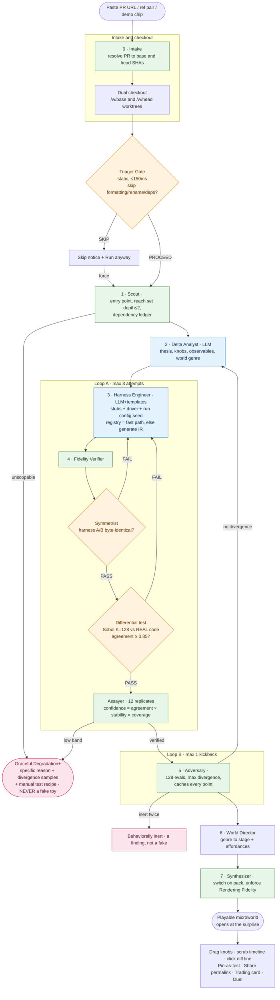

# Lever

### Turn a code diff into a *verified, playable* microworld.

> **Category:** Education · Developer Tools
> **Built with:** OpenAI Codex + GPT‑5.6 · E2B sandboxes · FastAPI · React
> **One line:** Paste a GitHub PR → an 8‑agent pipeline checks out both versions, executes the *real changed code* in a sandbox, differential‑tests old vs. new, and hands you a playable game of the behavioral change - or refuses honestly when it cannot prove the toy.

Lever is a PR‑review surface where understanding a change is a **motor act** (you drag a knob and watch old vs. new diverge) **backed by a measured claim** (nothing is rendered unless a differential test against the real code passed). Every competitor sells you a *summary* of a diff. Lever sells you a *playable differential* you can verify.

---

## Table of contents

1. [The problem](#1--the-problem)
2. [The solution](#2--the-solution)
3. [Why two tracks: Education + Developer Tools ](#3--why-two-tracks-developer-tools--education)
4. [Quick start (judges: test without rebuilding)](#4--quick-start)
5. [Architecture diagram](#5--architecture-diagram)
6. [How it works - end to end](#6--how-it-works--end-to-end)
7. [The agents (v2 six → v3 eight)](#7--the-agents-v2-six--v3-eight)
8. [The guardrails](#8--the-guardrails-the-trust-layer)
9. [Feature inventory (v2 → v3 → v3.1 interaction)](#9--feature-inventory)
10. [Domain packs & world genres](#10--domain-packs--world-genres)
11. [The hero corpus & the wild corpus](#11--the-hero-corpus--the-wild-corpus)
12. [Measured results](#12--measured-results)
13. [Tech stack](#13--tech-stack-complete)
14. [Installation & configuration](#14--installation--configuration)
15. [Built with Codex](#15--built-with-codex)
16. [Known limitations](#16--known-limitations-stated-on-purpose)
17. [New vs. prior work](#17--new-vs-prior-work--codex-evidence)
18. [Repository layout](#18--repository-layout)
19. [License](#19--license)

---

## 1 · The problem

Reviewing a pull request today means **reading two versions of code and simulating the difference in your head.** That mental simulation is exactly where bugs slip through:

- A rate limiter changes from a fixed window to a sliding window - *does it now admit 20× more traffic at high tenant counts?* You can't see it in the diff.
- A permission check moves from roles to attribute inheritance - *can a contractor now read the audit log across tenants?* One flipped boolean, invisible in text.
- A feature flag wraps existing pricing logic - *does the discount code silently never run for your beta cohort?* The diff looks fine.

Two tools try to help and both fall short:

- **AI PR summarizers** *describe* the change in prose. But a description is a claim with no evidence - and LLMs confidently narrate behavior that the code does not actually have.
- **Test suites** tell you *pass/fail* on the cases someone already thought of. They don't let you *feel* how behavior changes across the whole input space, and they say nothing about inputs no test covers.

The gap: **there is no tool that lets a reviewer interactively see, and trust, how a change alters real runtime behavior.**

## 2 · The solution

Lever closes that gap with one hard commitment:

> **It executes the real changed code in a sandbox and differential‑tests the microworld against that code. Only measured agreement may authorize a playable toy. If it cannot prove fidelity, it refuses - and still leaves you something useful.**

Concretely, for a PR Lever will:

1. **Check out both versions** (base and head) into isolated worktrees.
2. **Build a symmetric harness** - two runnable programs identical *byte‑for‑byte* except for which version of the code they import.
3. **Differential‑test** them against the real code across 128 low‑discrepancy sampled inputs.
4. **Measure confidence** from three independent quantities (agreement × stability × coverage) - never self‑reported by a model.
5. **Search** the input space for the point of maximum divergence - the "surprise."
6. **Render a game** (an arena of request particles, a permission matrix, a decision tree, a state workflow…) that opens *already showing the surprise*, and lets you drag knobs to watch old vs. new update live.
7. **Refuse honestly** if any step can't be verified - with a specific reason and a manual test recipe, never a fake.

The result is a **playable differential**: a small interactive world where the motion you see is downstream of a real, verified execution.

## 3 · Why two tracks: Developer Tools + Education

**Developer Tools** - Lever is a PR‑review and behavioral‑diff tool for engineers: paste a PR, get a verified interactive model of what changed, pin a divergence as a regression test, share a permalink to a live microworld. It targets code review, regression discovery, and "behavioral merge conflict" detection between two PRs.

**Education** - the same engine is a powerful learning surface. Abstract CS concepts - rate limiting, exponential backoff with jitter, access‑control inheritance, finite‑state machines, feature‑flag branch logic - become **interactive, verified simulations** a student can *play with* rather than read about. Because every animation is provably tied to real executed code (not a hand‑waved teaching applet), learners build correct intuition. Instructors can turn any small code change into a "what does this actually do?" microworld, and the "Break the PR" mode gamifies finding where two implementations disagree. Lever teaches the single most important review skill - *how a change to code changes behavior* - by making it a game.

## 4 · Quick start

> Judges can test Lever without rebuilding it from scratch. Fastest path is a curated demo; you can also paste a real PR.

**Prerequisites:** Python 3.12, Node ≥ 20.19, an `OPENAI_API_KEY`, an `E2B_API_KEY` (sandbox execution), and optionally a `GITHUB_TOKEN` (private repos / higher rate limits).

```bash
cd lever
python -m venv .venv && source .venv/bin/activate
pip install -r requirements.txt
cp .env.example .env          # fill OPENAI_API_KEY, E2B_API_KEY, (optional) GITHUB_TOKEN

# Backend (do NOT use --reload; it restarts mid-analysis when checkouts appear)
.venv/bin/uvicorn interface.api:app --host 127.0.0.1 --port 8765

# Frontend (separate terminal)
cd frontend && npm install && npm run dev
```

Open the printed UI URL (default `http://127.0.0.1:5173`). Health check: `GET http://127.0.0.1:8765/health`.

**Two ways to try it:**

- **Curated demo (surefire):** click a Hero chip (e.g. *Hero 1 - rate limiter*). You'll get the full Arena microworld.
- **Real PR:** paste a **public GitHub PR whose diff modifies one self‑contained function that takes plain data** (ints/strings/enums - no live `db`/request/session objects). Lever resolves it, checks out both commits, and renders the verified microworld - or an honest degradation.

> ⚠️ **Demo tip:** run the backend **without `uvicorn --reload`**. With reload on, the file watcher sees the PR checkout land under `data/checkouts/` and restarts the server mid‑run, killing the analysis. To keep reload while developing, scope it: `--reload-dir interface --reload-dir domain --reload-dir infra`.

## 5 · Architecture diagram

The trust pipeline - eight agents, four guardrails, two feedback loops, and the honest‑degradation exit:



**Reading the diagram:**
- **Green** = deterministic, (the trust‑critical parts must be reproducible).
- **Blue** = the only two steps that use an LLM (Delta Analyst proposes the spec; Harness Engineer proposes harness construction).
- **Orange** = the four guardrails that can veto a render.
- **Pink** = terminal honest outcomes (degradation or an "inert" finding) - both are legitimate answers, neither is a fake.
- **Loop A** (Harness Engineer ↔ Verifier) fixes a lying harness, escalating up to 3 attempts. 
- **Loop B** (Adversary → Delta Analyst) re‑picks knobs once if the change looks inert.

## 6 · How it works - end to end

Walking one PR through the pipeline:

1. **Intake** resolves the GitHub PR to `(repoUrl, baseSha, headSha)` and lists changed files (GitHub REST API).
2. **Dual checkout** materializes two worktrees, `/w/base` and `/w/head`, and selects the **primary Python pair** - one shared, modified, non‑test `.py` file that exists on both sides and takes plain data.
3. **Triager Gate** (pure static, tree‑sitter, ≤150ms) drops no‑op diffs (formatting, renames, dependency bumps, type‑only) with a *Run anyway* escape hatch. This is the cheapest, most load‑bearing feature - it stops the tool from "crying wolf."
4. **Scout** (deterministic) parses both trees, builds import + call graphs, computes the reachable set (bounded at depth 2), selects the entry point, and classifies every dependency as `pure | io | clock | random | network | db | native`.
5. **Delta Analyst** (GPT‑5.6, the one irreducibly‑LLM step) writes the **thesis** ("Old: fixed window. New: sliding window with per‑tenant burst"), the **knobs** (the controls you'll drag), the **observables** (what's measured), and the **world genre**.
6. **Harness Engineer** builds two runnable harnesses. A registry template is used as a *fast path* when the shape matches; otherwise it **generates a Harness IR** (an intermediate representation validated by schema, then rendered to source) using the versioned **Stub Library**. The two harnesses differ only by import root.
7. **Fidelity Verifier** runs, in order: the **Symmetrist** (proves the harnesses are byte‑identical except for justified diff‑introduced keys), the **differential test** (128 Sobol points, harness vs. *real* code, agreement rate), and the **Assayer** (12 replicates, perturbing only the stub parameters that had to be guessed, to measure stability). Confidence = `agreement × stability × coverage`.
8. **Adversary** searches for maximum divergence (64 explore + 64 exploit evaluations), caching every point - that cache doubles as the drag‑latency cache and the source for the decision‑tree reconstruction.
9. **World Director** maps the genre to a **stage** (arena, matrix, tree, workflow, curve) and **affordances** (particles, scrubber, fog, boss‑fight), writing structured `WorldSpec` fields.
10. **Synthesizer** mounts the browser microworld as a pure switch over the pack, enforcing Rendering Fidelity (zero‑anchored axes, divergence shown as a number, no auto‑zoom drama).
11. If anything unverifiable happens along the way → **Graceful Degradation+**: a specific reason, the sampled disagreements, and a manual test recipe. No toy.

## 7 · The agents

Lever started as **six agents** with deliberately opposed incentives. We added **two more** (Intake and World Director) and upgrades the Harness Engineer from registry‑lookup to generative construction - the change that makes "any PR" possible.

| # | Agent |  One‑line role |
|---|---|---|
| 0 | **Intake** | Resolve PR/ref/files → dual checkout + change manifest |
| 1 | **Scout** | Entry point, reach set (depth ≤ 2), dependency ledger |
| 2 | **Delta Analyst** | Thesis, knobs, observables, world genre |
| 3 | **Harness Engineer** | Generate symmetric stubs + driver + `run(config,seed)` |
| 4 | **Fidelity Verifier** | Symmetrist → differential test → Assayer |
| 5 | **Adversary** | Search for maximum divergence; cache every point |
| 6 | **World Director** | Choose interaction grammar + game affordances |
| 7 | **Synthesizer** | Mount the browser microworld from the completed spec |

### 0 · Intake
- **What it does:** parses a GitHub PR URL to `(owner, repo, number)`, calls the GitHub REST API for base/head SHAs and the changed‑file list, then dual‑checks‑out both commits into worktrees and selects the primary Python pair.
- **Why:** without it, Lever is a fixture player, not a product. This is the "paste a PR" capability.
- **Advantage:** turns Lever from a four‑hero demo into something a judge can point at *their own* PR.

### 1 · Scout 
- **What it does:** tree‑sitter parse of both trees → import/call graph → reachable set (depth‑2 bounded) → entry‑point selection (outermost changed function callable with plain data) → dependency ledger with each dep classified.
- **Why:** the Harness Engineer needs to know *what to stub*; the Assayer needs the uncertainty of each stub. Both come from Scout.
- **Advantage:** deterministic and fast - on the critical path, so this step is reproducible and cheap. Fails *loudly* (`unscopable`) rather than producing a garbage harness.

### 2 · Delta Analyst 
- **What it does:** reads both source versions + the dependency ledger and drafts the `InteractionSpec`: `thesis`, `domainPack`/genre, `knobs`, `observables`. Constrained decoding to the schema; a validator checks the chosen pack's arity contract, falling back to the always‑satisfiable `numeric-fn` pack on violation.
- **Why:** deciding *what the change is about* and *what to let the user pull on* is a genuine act of understanding - the one place a model is essential.
- **Advantage:** everything downstream is analysis/execution/templating, so the LLM's creativity is contained to a single, schema‑bounded step. If this step is wrong, verification still prevents a *false* toy - it just may be about the wrong thing.

### 3 · Harness Engineer 
- **What it does:** makes both versions runnable in isolation. For known shapes it uses a registry template (fast, high confidence). For unknown shapes it **generates a Harness IR** (`domain/harness_ir.py`) - entry, imports, stubs, driver, knob bindings, extractors, seed policy - validated by a Pydantic schema and rendered to source deterministically. Stubs come from the versioned **Stub Library** (`domain/stubs/`), each emitting an uncertainty spec for the Assayer.
- **Why:** the v2 hardcoded `ENTRY_POINT_REGISTRY` was a *gate* - any unknown function degraded immediately. v3 makes the registry an *accelerator*, not a gate.
- **Advantage:** generality. Lever can harness plain‑data callables it has never seen. The IR (LLM proposes JSON, deterministic renderer emits code) is safer and easier to Symmetrist‑diff than free‑form code generation, and model code is only ever executed inside the E2B sandbox - never on the host.

### 4 · Fidelity Verifier
- **What it does:** hosts the trust layer - **Symmetrist** (fail‑fast, no execution), then the **differential test** (128 Sobol points against real code), then the **Assayer** (12 replicates for stability). Emits the `FidelityReport` with a measured confidence and band.
- **Why:** this is *the* product. Without it, Lever is an LLM narrating what it thinks code does.
- **Advantage:** it is deliberately a **separate agent from the Harness Engineer, with the opposite objective** - the Engineer's job is to make code run; the Verifier's only reward is catching the Engineer cheating. Collapsing them would mean asking one prompt to critique itself.

### 5 · Adversary
- **What it does:** searches the knob space for the input of maximum divergence - 64 Sobol "explore" evals + coordinate ascent from the top‑8 for 64 "exploit" evals, 128 total, all cached. Writes `initialPosition`, `surpriseMarker`, and up to 3 measured `presets`.
- **Why:** a toy that opens at a boring default is a sandbox the user must explore themselves (and won't). Opening *at the surprise* converts a sandbox into a bug report.
- **Advantage:** the search cache doubles as the **drag‑latency cache** (why the toy feels instant) and the corpus for the decision‑tree reconstruction - one search, three jobs.

### 6 · World Director
- **What it does:** maps the world genre + cached evaluations to a `WorldSpec` - `stage` (arena/matrix/tree/curve/workflow), `affordances` (particles, scrubber, fog, boss‑fight), and a *measured‑only* narration line.
- **Why:** to make packs feel like **games**, not charts, without letting creativity break trust. It writes structured fields under arity contracts, so the Synthesizer stays a switch statement.
- **Advantage:** delight that never fabricates - every animated pixel is downstream of a real `ObservationBundle`.

### 7 · Synthesizer
- **What it does:** mounts the microworld as a pure switch over the domain pack, generates knob controls per type, builds the chart/stage, and **enforces Rendering Fidelity**. Never fails hard - falls back to `numeric-fn`.
- **Why:** consistency. A mechanical renderer means microworlds look the same across runs, so users build intuition across them.
- **Advantage:** the schema (`InteractionSpec` + `WorldSpec`) is what makes rendering a deterministic act instead of a creative one - the reason this can be a *no‑LLM* step.

## 8 · The guardrails (the trust layer)

Four guardrails and one exit protocol. **These are the product; everything else is the interface to them.**

### Triager Gate *(static, ≤150ms)*
First‑match‑wins static classifier over the two ASTs: formatting‑only → SKIP; rename‑only (alpha‑equivalent) → SKIP; dependency‑manifest‑only → SKIP; type‑annotations‑only → SKIP; zero behavioral edits → SKIP; else PROCEED. Every SKIP renders a one‑line reason plus **Run anyway →**. *Without it, the pipeline spends ~15s and real credits rendering two identical curves for a variable rename, and users learn the tool cries wolf.*

### Symmetrist Check
Proves the two harnesses' stub configs are **byte‑identical** over their shared keys, allowing a symmetric difference only for keys the diff itself justifiably added/removed (e.g. head introduces a Redis call). Canonicalization is exactly specified (sorted keys, 17‑sig‑fig floats, seed = `H(baseSeed, i)`, timestamps → epoch 0, canonical JSON). *This catches the single most dangerous silent failure: a fabricated divergence caused by asymmetric stubs (5ms vs 5.0ms, different seeds) that would pass every other test.*

### Assayer *(12 replicates)*
Perturbs **only the stub parameters the Harness Engineer had to guess** (I/O latency, cache miss rate, clock granularity…), each declared with an uncertainty distribution, and measures how much the answer wobbles. Two estimators by observable kind - coefficient of variation for numeric, instability rate for categorical (matrix cells, node states, path traces). Feeds `stability_factor`. *A route that flips in 3 of 12 replicates isn't a route you should show someone - confidence collapses and the tool degrades.*

The confidence formula (a **product**, so any weak factor dominates):

```
agreement_rate   = matched / samples                       # differential test
stability_factor = clamp(1 − max_instability / 0.25, 0, 1) # Assayer
coverage_factor  = min(1, log(1 + samples) / log(1 + 256))

confidence = agreement_rate × stability_factor × coverage_factor
```

| Band | Range | UI |
|---|---|---|
| **high** | ≥ 0.85 | Solid curves, green "Verified" badge |
| **medium** | 0.60–0.85 | Error bands (numeric) / hatching (categorical), amber badge |
| **low** | < 0.60 | **Degrade - no toy shown** |

### Rendering Fidelity *(enforced on every render)*
1. **Y‑axis zero‑anchored** on every numeric render - never auto‑scaled to a divergence region.
2. **Divergence magnitude always shown as a number** in the pack's own units ("20× more", "1 of 12 cells flipped"), never implied by visual scale.
3. **Zoom is manual and explicitly labeled** - never automatic. *Auto‑scaling a 3% gap to fill the chart is the same class of lie as an asymmetric harness, one layer up the stack - and it would pass the other three guardrails because none of them look at the chart.*

### Graceful Degradation+ *(the exit that makes the rest believable)*
When Scout can't scope, the harness can't be built after 3 attempts, agreement stays < 0.85, confidence is low, or there's no executable reference - Lever renders a **specific** `degradeReason` (named dependency, attempt count, failure mode), a **[Show me →]** divergence report, a plain explanation, and a **manual test recipe** (1–3 concrete inputs to try). **No toy is ever rendered.** *A tool that sometimes fabricates is worse than no tool, because it manufactures the exact false confidence Lever exists to cure. The 5% where it says "I don't know" is what makes the 95% believable.*

## 9 · Feature inventory

### v2 - the trust foundation
| Feature | What it does | Why it matters |
|---|---|---|
| Diff intake (PR URL / ref pair / raw diff) | Resolve a change to base/head SHAs | The substrate for A/B comparison |
| Dual checkout | Materialize `/w/base` + `/w/head` | The entire product is a comparison |
| Triager Gate + force‑proceed | Drop no‑op diffs, recover from false skips | Don't waste credits; don't cry wolf |
| Scout dependency ledger | Classify every transitive dep | Tells the harness what to stub |
| Differential test vs. real code | 128 Sobol points, agreement rate | The core trust claim |
| Symmetrist / Assayer / Rendering Fidelity | The three guardrails above | Measured, not claimed, fidelity |
| Adversary search + surprise marker | Open the toy at the interesting case | Turns a sandbox into a bug report |
| Knob drag + always‑on divergence view | Old & new update together, < 150ms | "The aha" - understanding as a motor act |
| Escape hatch to code | Click a point → jump to the responsible line | Closes the loop from behavior back to code |
| The Receipt | Real stack trace + downloadable harness | A skeptic can verify the claim in one click |
| Pin‑as‑test | Write a regression test at the current position | Play → durable artifact |
| Graceful Degradation | Honest refusal, never a fake | The credibility engine |

### v3 - generality, agency, game feel
| Feature | What it does | Why it matters |
|---|---|---|
| **GitHub PR intake** (`POST /prs`) | Paste any public PR | "Does this work on *my* PR?" |
| **Generative Harness (IR + Stub Library)** | Harness unknown plain‑data callables | Kills the hardcoded 4‑shape gate |
| **World Director + WorldSpec** | Genre → stage + affordances | Packs become games, not charts |
| **Arena stage** | Request particles through old/new gates | Throughput/retry changes you can *watch* |
| **Search fog** | Live knob‑space point cloud during search | The demo visibly *computes* before the toy mounts |
| **Session ledger + permalink** (`/m/:changeId`) | List + reopen past microworlds | Shareable, durable review artifacts |
| **Degradation+** | Adds a manual test recipe + static notes | Refusal that still delivers value |
| **Construction budget** | Caps runs/LLM calls/wall‑clock | Demos never hang |
| **Composed 2×2 microworld** | base/A/B/AB, detects behavioral merge conflicts | Two green PRs that break *together* |
| **State‑workflow genre** | Finite‑state‑machine transitions | A fifth visual grammar |

### v3.1 - interaction & shareability (Phase H)
| Feature | What it does | Why it matters |
|---|---|---|
| **Time‑travel code review** | Scrub the timeline; diff lines that executed *this frame* light up | See exactly which code ran for each input |
| **Diff‑as‑controller** | Click a diff line → jump to the first frame that executed it | The diff becomes a joystick into the microworld |
| **"Break the PR" challenge** | Hide the answer; race the Adversary to find divergence | Gamifies review; great for teaching |
| **Microworld trading card** | One‑click PNG of thesis + confidence + surprise | A shareable social artifact (no deps) |
| **Receipt duel / twin microworld** | Two changes, one synced scrubber, head‑to‑head risk verdict | Compare two PRs on the same subsystem |

## 10 · Domain packs & world genres

Delta Analyst selects a **domain pack** (visual grammar); the World Director maps it to a **genre + stage**. `numeric-fn` is the always‑satisfiable fallback.

| Pack | Genre | Requires | Renders as |
|---|---|---|---|
| `rate-limiter` | throughput / retry‑storm | ≥1 driver knob; 1 timeseries observable | Two overlaid curves / **Arena** of request particles |
| `permission` | access‑matrix | ≥2 enum knobs with `axisRole`; 1 matrixCell | Tappable grid; flipped cells outlined |
| `decision-tree` | decision‑path | 2–4 mixed knobs; 1 pathTrace | One **union tree**; fork ringed, unreached dimmed |
| `state-machine` | state‑workflow | ≥1 enum (event); 1 nodeState | Node graph; active state highlighted |
| `numeric-fn` | numeric‑response | ≥1 scalar knob; 1 scalar observable | Generic x→y, two curves. **Always satisfiable.** |

## 11 · The hero corpus & the wild corpus

**Four curated heroes** - each exercises a *different* pack, proving the schema generalizes rather than that one demo was hand‑built:

- **Hero 1 - rate limiter:** fixed‑window → sliding‑window with per‑tenant burst. Surprise: at high tenant counts the new version admits ~20× more (tenant isolation). *Arena.*
- **Hero 2 - retry backoff:** exponential → exponential with full jitter. Surprise: without jitter, 100 clients self‑synchronize into a thundering herd (spiky vs. smooth p99). *Arena / spike theater.*
- **Hero 3 - permission check:** role‑based → attribute‑based with group inheritance. Surprise: a contractor can now read the audit log across tenants - one cell flips red→green. *Matrix.*
- **Hero 4 - feature flag:** flat `if`s → logic nested inside a flag gate. Surprise: for the beta cohort the pricing code never runs. *Decision tree.*

**The Wild Three** (`docs/WILD_CORPUS.md`) proves the *full honesty spectrum* in one demo:

| ID | Source | Expected outcome |
|---|---|---|
| **W1** | `fixtures/wild_synth/` (unregistered function) | Verified via the **generative** harness - proves generality beyond the registry |
| **W2** | `fixtures/hero2/` | Verified throughput/retry Arena (retry loop visible in search fog) |
| **W3** | unscopable framework fixture | **Degradation+** - a live framework object → manual recipe, no fake |

## 12 · Measured results

Lever tracks, on every run, which terminal outcome each change reaches: **verified (high/medium) · inert · unscopable · unharnessable · unverifiable**. Credibility over bluff - the honest number goes here.

**Reproduce:**
```bash
cd lever && source .venv/bin/activate
python scripts/run_wild_corpus.py     # prints a per‑fixture outcome table + hit rate
```

**Last measured (unit‑corpus path):** `hit_rate_verified_or_honest = 1.0` across the Wild Three - **W1** verified through the generative Harness IR, **W2** verified as a hero fixture + genre, **W3** correctly routed to Degradation+. That metric is deliberately defined as *"reached a verified microworld **or** an honest degradation"* - i.e. **it never produced a silent fake** on the corpus.

**Honest framing for arbitrary PRs.** Lever targets **behavioral Python PRs with a plain‑data callable core**. It will *not* verify a change whose only modified functions require a live `db`/session/request object, or a change that is purely additive (no old behavior to diff against) - those degrade **by design**. This is the D(x)/framework‑boundary limit (see §16), and the degradation is a feature, not a crash. The raw verified‑fraction on arbitrary public PRs is bounded by that constraint; the value Lever guarantees is that **it is never wrong about what it verified**.

### Automated test suite

Lever ships **168 automated tests - all green** (130 backend + 38 frontend). The trust‑critical pieces are unit‑tested deterministically, so the guarantees hold in the *live* path, not just in prose. Judges can reproduce every number below in under two minutes.

**Backend - pytest**

| Metric | Value |
|---|---|
| Test files | **39** (32 for Lever's own agents/guardrails/API + 7 hero fixture reference suites) |
| Tests collected | **130** |
| Result | **129 passed · 1 skipped** (~59s) |
| The 1 skip | a *live* E2B sandbox integration test, skipped on the offline unit path (runs only with `E2B_API_KEY` + network) |

What's covered and why:
- **Per‑agent tests** - `test_scout`, `test_delta_analyst`, `test_harness_engineer`, `test_generative_harness`, `test_fidelity_verifier`, `test_adversary`, `test_synthesizer`, `test_world_director`, `test_intake` - each agent's contract is pinned independently.
- **Guardrail tests** - `test_symmetrist` (byte‑identity invariant), `test_triager` (skip classification), `test_branch_instrumentation`, plus Assayer/Rendering‑Fidelity behavior - the *trust layer* is verified in isolation.
- **API tests** - `test_pr_intake_api`, `test_sessions_api`, `test_degradation_api`, `test_phase_ef_api`, `test_api` - the FastAPI edge and the "never render a fake" degradation path.
- **Infra adapters** - `test_pr_resolver` (GitHub), `test_dual_checkout`, `test_sqlite_adapter`, `test_openai_adapter`, `test_e2b_adapter*`.
- **Hero reference suites** - each hero fixture ships its own tests (`fixtures/hero1..4/tests`) that satisfy the executable‑reference precondition the Verifier requires.

**Frontend - Vitest + Testing Library (jsdom)**

| Metric | Value |
|---|---|
| Test files | **16** |
| Tests | **38 passed** (~8s) |

What's covered: component tests for every stage and interaction surface - `ArenaStage`, `UnionTree`, `PermissionMatrix`/matrix, `CodeDiff`, `ChallengePanel`, `ReceiptDuel`, `ComposedMicroworld`, `ObjectiveSelector`, `SearchTrace`, `SourceViewer`, and **`HonestChart` + `HonestChart.types`** (the zero‑anchored‑axis Rendering‑Fidelity guarantee) - plus App‑level flows (`App.search-trace`, `App.escape-hatch`, `App.degradation`).

**Reproduce (the proof):**
```bash
# Backend → 129 passed, 1 skipped
.venv/bin/python -m pytest -q --ignore=data --ignore=pinned_tests

# Frontend → 38 passed  (uses --environment jsdom via the npm script)
cd frontend && npm test
```

> Note: run the frontend suite via `npm test` (it sets `--environment jsdom`). A bare `vitest run` without that flag fails on `document is not defined` - a harness detail, not a product failure.

## 13 · Tech stack (complete)

**Backend (Python 3.12)**
- **FastAPI 0.139** + **uvicorn[standard] 0.51** - REST + WebSocket event stream (`/prs`, `/demos`, `/diffs/{id}`, `/sessions`, `/health`, `/ws/{changeId}`).
- **Pydantic 2.13** - the `InteractionSpec` / `WorldSpec` / Harness IR schemas that make rendering mechanical.
- **tree‑sitter 0.26** + **tree‑sitter‑python 0.25** - deterministic parsing for the Triager and Scout.
- **OpenAI 2.46 SDK** (GPT‑5.6) - the two LLM steps (Delta Analyst, Harness Engineer proposer), via a port so `domain/` never imports it directly.
- **E2B 2.34** - sandboxed execution of real checked‑out code and model‑generated harnesses (never on the host).
- **httpx 0.28** - GitHub REST for PR resolution.
- **numpy 2.5 / scipy 1.18** - Sobol low‑discrepancy sampling and the Assayer's statistics.
- **SQLite** (stdlib) - the durable session ledger.
- **pytest 9.1** - the test suite.

**Frontend (TypeScript, React 19)**
- **Vite 8** + **@vitejs/plugin-react** - dev server & build.
- **React 19** + **Zustand 5** - UI and the interactive knob/position store.
- **Recharts 3** - charts, imported through a single `HonestChart` boundary that enforces zero‑anchored axes.
- **Tailwind CSS 4** (`@tailwindcss/vite`) - styling.
- **Vitest 3** + **@testing-library/react** + **jsdom** - component tests.
- **oxlint** + **TypeScript 6** - linting & type checking.

**Architecture:** hexagonal - `domain/` is pure logic behind `Protocol` ports (`domain/ports.py`); adapters for OpenAI, E2B, GitHub, and SQLite live in `infra/`; `interface/api.py` is the FastAPI edge.

## 14 · Installation & configuration

**Supported platforms:** macOS and Linux (developed on macOS; the sandbox and toolchain are POSIX‑oriented).

**Required environment (`.env`):**
```
OPENAI_API_KEY=sk-...            # required - GPT‑5.6 for Delta Analyst & Harness proposer
E2B_API_KEY=e2b_...              # required - sandboxed execution
GITHUB_TOKEN=ghp_...             # optional - private repos / higher GitHub rate limits
LEVER_LLM_TIMEOUT_SECONDS=240    # optional - widen the LLM budget for large PRs
LEVER_SANDBOX_TEMPLATE=base      # optional - match the sandbox Python to the host
```

**Run:** see [Quick start](#4--quick-start). Backend on `:8765`, frontend on `:5173`. Do **not** use `uvicorn --reload` during analysis.

**Test:**
```bash
.venv/bin/python -m pytest -q --ignore=data --ignore=pinned_tests
cd frontend && npm test
```

## 15 · Built with Codex

Lever was built during the OpenAI Build Week using **OpenAI Codex and GPT‑5.6** as an active engineering collaborator throughout, against a spec‑first workflow.

**Where Codex accelerated the work:**
- **Scaffolding the eight‑agent pipeline** - Codex generated the initial `domain/` modules (Scout, Delta Analyst, Harness Engineer, Fidelity Verifier, Adversary, Synthesizer) against the locked `InteractionSpec` schema, then Intake and World Director for v3.
- **The generative Harness IR** - designing the intermediate representation and its deterministic renderer (`domain/harness_ir.py`) was iterated heavily with Codex, including the subtle routing of categorical vs. numeric driver knobs.
- **Frontend microworlds** - the Arena, permission matrix, decision‑tree, workflow stages, timeline scrubber, and the Phase‑H features (time‑travel review, diff‑as‑controller, challenge mode, trading card, receipt duel) were built with Codex.
- **Tests & hardening** - pytest and Vitest suites, graceful‑degradation error paths, and version‑mismatch handling were co‑written with Codex.
- **GPT‑5.6 at runtime** - the  live LLM steps call GPT‑5.6 with constrained/schema‑bounded decoding.

**Where we made the key product / engineering decisions:**
- **The trust invariant** - "never render a toy without a passing differential test against the real code, and refuse honestly otherwise." Every architectural choice defends it.
- **Six agents with opposed incentives** - separating the Harness Engineer (make it run) from the Fidelity Verifier (catch it cheating) is a human design decision, not a modularity convenience.
- **Deterministic guardrails never call an LLM** - Triager, Scout's static core, Symmetrist, Assayer math, and the Synthesizer switch are pure functions on purpose.
- **Rendering Fidelity & the "no fake" degradation** - the decision that an exaggerated axis is the same lie as an asymmetric harness, and that honest refusal beats a silent fake.
- **v3 scope calls** - Python‑only for the win build; registry as an accelerator not a gate; game feel *after* generality + trust.

Evidence of in‑window Codex/GPT‑5.6 use is in the dated git history and the phased build docs (`docs/BUILD_PLAN_V3.md`).

> Fill in before submitting: the **`/feedback` Codex Session ID** for the thread where the majority of core functionality was built (Devpost submission field), and the **demo video** link.

## 16 · Known limitations (stated on purpose)

The house style is honest confidence over silent overreach. A stated blind spot is cheaper credibility than a hidden one.

- **D(x) blindness - Lever measures what code returns, not how it got there.** A refactor that produces identical outputs by a different route reports as *behaviorally inert*, even if something structurally significant changed (e.g. a new dependency on a permission service). The `decision-tree` pack's path‑divergence objective partially mitigates this for that pack only; the general limit stands.
- **Framework/DB‑coupled changes degrade by design.** If the only changed functions need a live `db`/session/request object, Lever refuses rather than faking one. (Ephemeral seeded backends and framework test‑client harnesses are the planned, unimplemented.)
- **Purely additive PRs have nothing to diff.** Differential testing needs a function present in *both* base and head; brand‑new functions have no "old" behavior to compare against.
- **Reach depth 2.** Second‑order effects beyond two hops are invisible; blast‑radius detection is excluded on soundness grounds (static analysis can't see dynamic dispatch/reflection/event buses).
- **No executable reference → no verification.** A repo with no runnable reference path routes to degradation.
- **Empirical, not proven, coverage.** "Never reached across 128 sampled inputs" is a measurement, not a proof of unreachability - and is labeled as such.

---

### Further reading
- [`docs/SPEC.md`](docs/SPEC.md) - the v2 trust bible (Symmetrist, Assayer, packs, agent contracts)
- [`docs/SPEC_V3.md`](docs/SPEC_V3.md) - the v3 win spec (PR intake, generative harness, world genres)
- [`docs/BUILD_PLAN_V3.md`](docs/BUILD_PLAN_V3.md) - phased build order (A–H)
- [`docs/WILD_CORPUS.md`](docs/WILD_CORPUS.md) - the Wild Three honesty corpus
- [`docs/BUILD_PLAN_PHASE_G.md`](docs/BUILD_PLAN_PHASE_G.md) - planned framework/DB support (not implemented)
