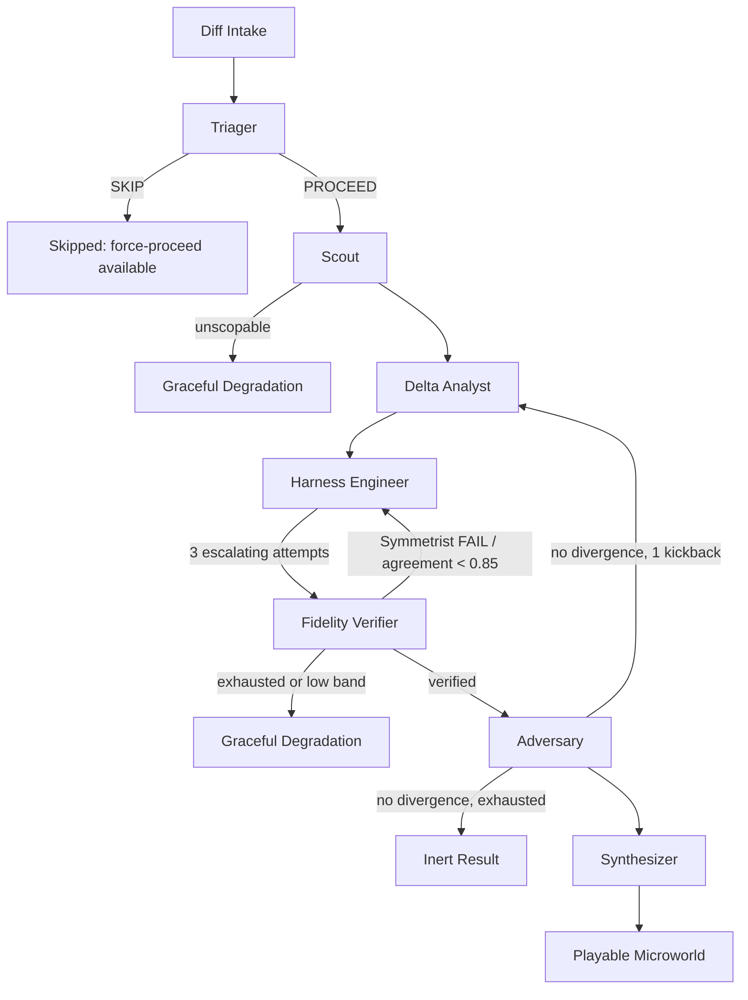

# Lever Audit Remediation — Implementation Plan

> **For agentic workers:** REQUIRED SUB-SKILL: Use superpowers:subagent-driven-development (recommended) or superpowers:executing-plans to implement this plan task-by-task. Steps use checkbox (`- [ ]`) syntax for tracking.

**Goal:** Close every gap found by the four-way phase audit (docs/SPEC.md compliance review) so Lever's four heroes are actually reachable end-to-end through the shipped UI, the test suite is green, and the pipeline's own escalation/verification guarantees hold in the live path, not just in isolated unit tests.

**Architecture:** No new subsystems. Every task extends an existing seam (`domain/*` pure logic, `infra/*` adapters, `interface/api.py` FastAPI routes, `frontend/src/components/*`) without changing the hexagonal port boundaries established in Phase 0.

**Tech Stack:** Python 3.11 (FastAPI, Pydantic v2, pytest), React 19 + Vite + Zustand + Recharts + TanStack Query (frontend), SQLite (WAL), e2b sandboxes.

## Global Constraints

- Python venv must be 3.11 (`~/.pyenv/versions/3.11.14`) — the repo's ambient `.python-version` (3.10.12) and pinned `requirements.txt` (`numpy==2.5.1`, `scipy==1.18.0`) both require Python ≥3.12, which is not installed on this machine. Use `numpy==2.4.6` / `scipy==1.17.1` for local dev until a 3.12 interpreter exists; do not change `requirements.txt`'s pins without confirming CI/deploy uses a real 3.12 interpreter.
- This worktree's Python venv already exists at `.venv/` (3.11.14, with the overrides above already installed) — use `.venv/bin/python`/`.venv/bin/pip` directly; do not rebuild it per task.
- Frontend commands require Node ≥20.19 (vite/rolldown's native binding fails to resolve on the ambient default Node v20.18.3 — both as a missing `@rolldown/binding-darwin-arm64` and as an `ERR_REQUIRE_ESM` failure inside jsdom's CSS parser). Node v22.22.2 is available via nvm but does not persist across separate shell invocations — prefix every frontend command with `source ~/.nvm/nvm.sh 2>/dev/null && nvm use 22.22.2 >/dev/null 2>&1 &&`. A `.nvmrc` pinning `22.22.2` already exists in `frontend/`.
- No task may weaken an existing guardrail: the Symmetrist check, the differential test, the Assayer, Rendering Fidelity (zero-anchored axes), or Graceful Degradation's "never render a widget" invariant.
- Every backend task ends with the full suite green: `.venv/bin/python -m pytest -q`.
- Every frontend task ends with `source ~/.nvm/nvm.sh 2>/dev/null && nvm use 22.22.2 >/dev/null 2>&1 && npm test -- --run` and `npm run build` (from `frontend/`), both clean.
- Commit after each task individually — do not batch commits across tasks.

---

### Task 1: Fix the stale pinned harness hash (Phase 8 regression)

**Files:**
- Modify: `domain/tests/test_harness_engineer.py:197` (the hardcoded SHA-256 literal)

**Context:** Running the full suite currently produces `1 failed, 105 passed, 1 skipped`. The single failure is `test_generated_hero1_harnesses_execute_the_real_fixture_modules`, which asserts a hardcoded hash of the generated Hero 1 harness source. The behavioral assertions in the same test (both harnesses execute with returncode 0, `admitted: 5` for base, `admitted: 6` for head, template registered) all pass — only the byte-hash is stale, because an earlier commit added trailing newlines to `fixtures/hero1/base.py`/`head.py` to make patch-application machinery (Task 8's predecessor, already shipped) line up. The harness generator is deterministic, so the new hash is stable — it just needs to be re-pinned.

- [ ] **Step 1: Confirm the current (correct) hash**

Run:
```bash
.venv/bin/python -m pytest domain/tests/test_harness_engineer.py::test_generated_hero1_harnesses_execute_the_real_fixture_modules -v 2>&1 | grep -A2 "AssertionError"
```
Expected output includes a line `+ <64-hex-char string>` — that is the new correct hash.

- [ ] **Step 2: Replace the stale literal**

In `domain/tests/test_harness_engineer.py:197`, replace the existing hardcoded hex string with the value captured in Step 1.

- [ ] **Step 3: Run the full suite to confirm zero failures**

Run: `.venv/bin/python -m pytest -q`
Expected: `106 passed, 1 skipped` (no failures).

- [ ] **Step 4: Commit**

```bash
git add domain/tests/test_harness_engineer.py
git commit -m "fix: re-pin Hero 1 harness hash after fixture newline normalization"
```

---

### Task 2: Fix hardcoded absolute fixture paths in the frontend (demo blocker)

**Files:**
- Modify: `frontend/src/App.tsx:28-35` (the `HERO_1` constant)
- Create: `frontend/.env.local` (gitignored — do not commit)
- Modify: `frontend/.env.example` (create if it doesn't exist, so the fallback paths are documented rather than silently broken)

**Context:** `App.tsx` hardcodes `/Users/karandoshi/Desktop/Karan Doshi/Projects/OpenAI Hackathon/lever/fixtures/hero1/base.py` as a fallback when `VITE_HERO1_BASE_FILE_PATH` is unset. That path doesn't exist on this machine (`/Users/khushisidana/LEVER`), so any demo run without the env var set silently 404s or reads the wrong file. This blocks every other frontend task in this plan from being demoable locally.

- [ ] **Step 1: Write `frontend/.env.example`**

```
VITE_LEVER_API_BASE=http://127.0.0.1:8765
VITE_HERO1_BASE_FILE_PATH=/Users/khushisidana/LEVER/fixtures/hero1/base.py
VITE_HERO1_HEAD_FILE_PATH=/Users/khushisidana/LEVER/fixtures/hero1/head.py
VITE_HERO2_BASE_FILE_PATH=/Users/khushisidana/LEVER/fixtures/hero2/base.py
VITE_HERO2_HEAD_FILE_PATH=/Users/khushisidana/LEVER/fixtures/hero2/head.py
VITE_HERO3_BASE_FILE_PATH=/Users/khushisidana/LEVER/fixtures/hero3/base.py
VITE_HERO3_HEAD_FILE_PATH=/Users/khushisidana/LEVER/fixtures/hero3/head.py
VITE_HERO4_BASE_FILE_PATH=/Users/khushisidana/LEVER/fixtures/hero4/base.py
VITE_HERO4_HEAD_FILE_PATH=/Users/khushisidana/LEVER/fixtures/hero4/head.py
```

- [ ] **Step 2: Copy it to the real (gitignored) env file**

```bash
cp frontend/.env.example frontend/.env.local
```

- [ ] **Step 3: Replace the hardcoded fallback in `App.tsx`**

Replace lines 28-35:
```tsx
const HERO_1 = {
  base_file_path:
    import.meta.env.VITE_HERO1_BASE_FILE_PATH ??
    '/Users/karandoshi/Desktop/Karan Doshi/Projects/OpenAI Hackathon/lever/fixtures/hero1/base.py',
  head_file_path:
    import.meta.env.VITE_HERO1_HEAD_FILE_PATH ??
    '/Users/karandoshi/Desktop/Karan Doshi/Projects/OpenAI Hackathon/lever/fixtures/hero1/head.py',
}
```
with (this also lays groundwork for Task 4's hero switcher, which replaces the single `HERO_1` constant with a `HEROES` map):
```tsx
type HeroConfig = Readonly<{ id: string; label: string; base_file_path: string; head_file_path: string }>

function requireEnv(key: string): string {
  const value = import.meta.env[key]
  if (!value) {
    throw new Error(`Missing required env var ${key} — copy frontend/.env.example to frontend/.env.local`)
  }
  return value
}

const HEROES: readonly HeroConfig[] = [
  {
    id: 'hero1',
    label: 'Hero 1 — rate limiter',
    base_file_path: requireEnv('VITE_HERO1_BASE_FILE_PATH'),
    head_file_path: requireEnv('VITE_HERO1_HEAD_FILE_PATH'),
  },
]
```
(Task 4 extends `HEROES` with hero2/hero3/hero4 entries once the backend registers them.)

- [ ] **Step 4: Update all `HERO_1` references in the same file to use `HEROES[0]`**

Run `grep -n "HERO_1" frontend/src/App.tsx` and replace each usage with the selected hero from `HEROES` (Task 4 wires the actual selection state; for this task, hardcode `const selectedHero = HEROES[0]` at the top of the component so behavior is unchanged).

- [ ] **Step 5: Verify the app still boots against the real fixture**

```bash
cd frontend && npm run build
```
Expected: clean build, no TypeScript errors.

- [ ] **Step 6: Commit**

```bash
git add frontend/.env.example frontend/src/App.tsx
git commit -m "fix: replace hardcoded absolute fixture paths with env-driven hero config"
```

---

### Task 3: Wire Harness Engineer's retry-escalation into the live Orchestrator loop

**Files:**
- Modify: `domain/harness_engineer.py:124-232` (`HarnessEngineer.generate`, `build_harness_pair`)
- Modify: `domain/fidelity_verifier.py:88-100` (`FidelityVerifier.verify`)
- Modify: `domain/orchestrator.py:164-296` (Loop A)
- Test: `domain/tests/test_harness_engineer.py` (extend), `domain/tests/test_orchestrator.py` (extend)

**Context:** `retry_plan()` (harness_engineer.py:302) and `RetryAttempt` are fully implemented and unit-tested in isolation, but `orchestrator.py`'s Loop A calls `HarnessEngineer().generate()` with byte-identical arguments on every attempt — the escalating stub-set/clock-seeding/tolerance-widening described in the spec never actually happens live. Two `TODO(phase-4)` comments in `harness_engineer.py:318,338` acknowledge this. This task makes attempts 1 and 2 real (stub-set escalation driven by the Symmetrist's `unjustifiedKeys`, plus forced clock/random seeding) and makes attempt 3's tolerance widening real. Attempt 3's "reduce scope to the innermost changed function" is *not* implemented — there is no registry mechanism to re-target Scout's entry point mid-retry, and building one is out of scope here; attempt 3 keeps the same entry point but does apply the widened ε=0.05 tolerance and full-dependency stubbing. Note this honestly in the commit message; do not claim full spec parity.

**Interfaces:**
- Consumes: `RetryAttempt(number, stubbed_dependencies, seed_clock, seed_random, scope_target, tolerance)` and `VerifierFeedback(implicated_dependencies)` from `domain/harness_engineer.py` (already defined, lines 94-110).
- Produces: `HarnessEngineer.generate(..., retry_attempt: RetryAttempt | None = None)` and `FidelityVerifier.verify(..., tolerance_override: RelativeTolerance | AbsoluteTolerance | ExactTolerance | None = None)` — both consumed by `orchestrator.py`.

- [ ] **Step 1: Write the failing test for stub-set restriction**

Add to `domain/tests/test_harness_engineer.py`:
```python
def test_retry_attempt_restricts_stubbed_dependencies_to_the_named_set() -> None:
    """Attempt 1 must not stub a dependency outside its minimal (network/db/native) set."""
    scope = _hero_scope()  # existing helper in this file; has one clock + one random dep
    spec = _hero_spec()
    attempts = retry_plan(scope)
    pair = HarnessEngineer().generate(
        scope, spec, str(FIXTURE_DIR / "base.py"), str(FIXTURE_DIR / "head.py"),
        retry_attempt=attempts[0],
    )
    stubbed_kinds = {stub.kind for stub in pair.stub_config}
    assert "clock" not in stubbed_kinds
    assert "random" not in stubbed_kinds


def test_retry_attempt_two_forces_clock_and_random_stubs() -> None:
    scope = _hero_scope()
    spec = _hero_spec()
    attempts = retry_plan(scope)
    pair = HarnessEngineer().generate(
        scope, spec, str(FIXTURE_DIR / "base.py"), str(FIXTURE_DIR / "head.py"),
        retry_attempt=attempts[1],
    )
    stubbed_kinds = {stub.kind for stub in pair.stub_config}
    assert {"clock", "random"} <= stubbed_kinds
```
(If Hero 1's dependency ledger has no `clock`/`random` entries, use `test_hero2_registry.py`'s scope helper instead — Hero 2's retry-backoff fixture depends on both `random.uniform` and a clock read. Check `domain/tests/test_hero2_registry.py` for its existing scope-builder name before writing this.)

- [ ] **Step 2: Run to verify it fails**

```bash
.venv/bin/python -m pytest domain/tests/test_harness_engineer.py -k retry_attempt -v
```
Expected: FAIL with `TypeError: generate() got an unexpected keyword argument 'retry_attempt'`.

- [ ] **Step 3: Add `retry_attempt` to `HarnessEngineer.generate` and `build_harness_pair`**

In `domain/harness_engineer.py`, change the signature at line 124:
```python
    def generate(
        self,
        scoped_change_set: ScopedChangeSet,
        partial_spec: PartialInteractionSpec,
        base_module_path: str,
        head_module_path: str,
        base_source: str | None = None,
        head_source: str | None = None,
        retry_attempt: RetryAttempt | None = None,
    ) -> HarnessPair:
        """Generate the base/head pair from one template with import path as its sole delta."""
        return build_harness_pair(
            scoped_change_set,
            partial_spec.knobs,
            partial_spec.observables,
            base_module_path,
            head_module_path,
            domain_pack=partial_spec.domainPack,
            base_source=base_source,
            head_source=head_source,
            retry_attempt=retry_attempt,
        )
```
Change `build_harness_pair`'s signature at line 146 to add `retry_attempt: RetryAttempt | None = None` as the last parameter, and replace the stub-selection block at lines 182-189:
```python
    if retry_attempt is None:
        allowed_names: set[str] | None = None
        include_clock = True
        include_random = True
    else:
        allowed_names = set(retry_attempt.stubbed_dependencies)
        include_clock = retry_attempt.seed_clock
        include_random = retry_attempt.seed_random
    stubs = tuple(
        _dependency_stub(entry)
        for entry in scoped_change_set.dependency_ledger.entries
        if entry.kind != "pure"
        and entry.kind not in template.symmetrically_seeded_dependency_kinds
        and (
            allowed_names is None
            or entry.name in allowed_names
            or (entry.kind == "clock" and include_clock)
            or (entry.kind == "random" and include_random)
        )
    )
```
This preserves the current default behavior (stub everything non-pure) when `retry_attempt` is `None`, which is what every pre-existing passing test relies on.

- [ ] **Step 4: Run to verify the new tests pass and nothing else broke**

```bash
.venv/bin/python -m pytest domain/tests/test_harness_engineer.py -v
```
Expected: all pass, including the two new tests.

- [ ] **Step 5: Add `tolerance_override` to `FidelityVerifier.verify`**

In `domain/fidelity_verifier.py`, change the signature at line 88 to add `tolerance_override: RelativeTolerance | AbsoluteTolerance | ExactTolerance | None = None` as the last parameter, and change line 100:
```python
        tolerance = tolerance_override or _report_tolerance(partial_spec.observables)
```
Add the import at the top of the file: `from domain.schema import AbsoluteTolerance, RelativeTolerance, ExactTolerance` (add to the existing `from domain.schema import (...)` block if one exists — check first with `grep -n "^from domain.schema" domain/fidelity_verifier.py`).

- [ ] **Step 6: Write the failing orchestrator-level test proving escalation actually changes harness content across retries**

Add to `domain/tests/test_orchestrator.py`:
```python
def test_loop_a_retry_actually_escalates_stub_scope_between_attempts() -> None:
    """A Symmetrist failure on attempt 1 must produce a DIFFERENT, wider-stubbed harness
    on attempt 2 — not a byte-identical re-generation of the same pair."""
    calls: list[HarnessPair] = []
    original_generate = HarnessEngineer.generate

    def recording_generate(self, *args, **kwargs):
        pair = original_generate(self, *args, **kwargs)
        calls.append(pair)
        return pair

    monkeypatch_target = "domain.orchestrator.HarnessEngineer.generate"
    with mock.patch(monkeypatch_target, recording_generate):
        # Use a FidelityVerifier fake that fails Symmetrist on attempt 1 only,
        # matching this file's existing scripted-verifier pattern.
        run_pipeline(..., sandbox=..., llm=...)  # reuse this file's existing hero1 fixture args

    assert len(calls) >= 2
    first_stub_names = {stub.dependency for stub in calls[0].stub_config}
    second_stub_names = {stub.dependency for stub in calls[1].stub_config}
    assert second_stub_names != first_stub_names or (
        # if Hero 1 has no escalatable deps beyond minimal, at minimum the
        # harness source itself must differ (clock/random seeding changes text)
        calls[0].harness_a.source != calls[1].harness_a.source
    )
```
Adapt this to whatever scripted-`FidelityVerifier`/monkeypatch pattern `test_orchestrator.py` already uses elsewhere in the file (read `test_orchestrator.py:248-296`, the existing `test_loop_a_reenters...` test, and follow its exact fixture/mocking style rather than introducing a new one).

- [ ] **Step 7: Run to verify it fails**

```bash
.venv/bin/python -m pytest domain/tests/test_orchestrator.py -k escalates -v
```
Expected: FAIL — `calls[0].stub_config` and `calls[1].stub_config` are currently identical.

- [ ] **Step 8: Wire retry_plan/VerifierFeedback into orchestrator.py's Loop A**

In `domain/orchestrator.py`, add the import at line 13:
```python
from domain.harness_engineer import (
    HarnessEngineer,
    NO_HARNESS_TEMPLATE_REASON,
    NoHarnessTemplateRegistered,
    UnsupportedTemplateProposal,
    VerifierFeedback,
    retry_plan,
)
from domain.schema import RelativeTolerance
```
Immediately before the `for loop_a_attempt in range(1, MAX_LOOP_A_ATTEMPTS + 1):` loop at line 165, add:
```python
            retry_attempts = retry_plan(scoped_change_set)
            verifier_feedback = VerifierFeedback()
```
Replace the `harness_pair = HarnessEngineer().generate(...)` call at line 167 (the primary one, not the fallback branch's second call at line 217) with:
```python
                current_attempt = (
                    retry_attempts[loop_a_attempt - 1]
                    if loop_a_attempt == 1
                    else retry_plan(scoped_change_set, verifier_feedback)[loop_a_attempt - 1]
                )
                try:
                    harness_pair = HarnessEngineer().generate(
                        scoped_change_set,
                        partial_spec,
                        _SANDBOX_BASE_MODULE,
                        _SANDBOX_HEAD_MODULE,
                        base_source,
                        head_source,
                        retry_attempt=current_attempt,
                    )
```
Replace the `fidelity = FidelityVerifier(sandbox).verify(...)` call at line 258 with:
```python
                fidelity = FidelityVerifier(sandbox).verify(
                    sandbox_id,
                    harness_pair,
                    scoped_change_set,
                    partial_spec,
                    base_source,
                    head_source,
                    tolerance_override=RelativeTolerance(
                        kind="relative", epsilon=0.05 if current_attempt.number == 3 else 0.01
                    ),
                )
```
Replace the `continue` at line 269 (`if not report.symmetrist.passed or report.agreement.rate < 0.85:`) with:
```python
                if not report.symmetrist.passed or report.agreement.rate < 0.85:
                    # LOOP A: the next iteration re-enters precisely at Harness Engineer,
                    # now with real escalation instead of a byte-identical retry.
                    verifier_feedback = VerifierFeedback(
                        implicated_dependencies=tuple(report.symmetrist.unjustifiedKeys)
                    )
                    continue
```

- [ ] **Step 9: Run to verify both new tests pass**

```bash
.venv/bin/python -m pytest domain/tests/test_harness_engineer.py domain/tests/test_orchestrator.py -v
```
Expected: all pass.

- [ ] **Step 10: Run the full suite**

```bash
.venv/bin/python -m pytest -q
```
Expected: no regressions vs. Task 1's baseline.

- [ ] **Step 11: Commit**

```bash
git add domain/harness_engineer.py domain/fidelity_verifier.py domain/orchestrator.py domain/tests/test_harness_engineer.py domain/tests/test_orchestrator.py
git commit -m "fix: wire Harness Engineer's escalating retry plan into the live Orchestrator loop

Loop A previously called HarnessEngineer.generate() with identical arguments
on every attempt; retry_plan()/RetryAttempt existed but were dead code from
the orchestrator's perspective. Attempts 1-2 now genuinely change which
dependencies get stubbed (driven by the Symmetrist's unjustifiedKeys), and
attempt 3 genuinely widens tolerance to relative eps=0.05. Attempt 3's
'reduce scope to the innermost function' is intentionally not implemented —
no registry mechanism exists to re-target Scout's entry point mid-retry."
```

---

### Task 4: Register Hero 2 & Hero 3 in the live API and add a hero switcher

**Files:**
- Modify: `interface/api.py:51-59` (`HERO_FIXTURES`)
- Modify: `frontend/src/App.tsx` (the `HEROES` array from Task 2, plus a switcher control)
- Test: `interface/tests/test_api.py` (extend)

**Context:** The backend's `/heroes/{hero_id}/run` endpoint only registers `hero1` and `hero4`. Hero 2 and Hero 3 have working domain-layer fixtures and registry entries (proven by `domain/tests/test_hero2_registry.py`, `test_hero3_registry.py`) but are unreachable via the API, and the frontend hardcodes Hero 1 with no way to select another. This task makes all four heroes reachable end to end through the running app.

- [ ] **Step 1: Write the failing API test**

Add to `interface/tests/test_api.py` (follow the existing hero1/hero4 test pattern in the same file — search `grep -n "heroes/hero1\|heroes/hero4" interface/tests/test_api.py` for the exact existing assertions to mirror):
```python
def test_run_hero2_is_registered() -> None:
    response = client.post("/heroes/hero2/run")
    assert response.status_code != 404


def test_run_hero3_is_registered() -> None:
    response = client.post("/heroes/hero3/run")
    assert response.status_code != 404
```

- [ ] **Step 2: Run to verify it fails**

```bash
.venv/bin/python -m pytest interface/tests/test_api.py -k "hero2_is_registered or hero3_is_registered" -v
```
Expected: FAIL, 404.

- [ ] **Step 3: Register hero2 and hero3**

In `interface/api.py:51`, extend `HERO_FIXTURES`:
```python
HERO_FIXTURES: dict[str, tuple[Path, Path]] = {
    "hero1": (
        _PROJECT_ROOT / "fixtures/hero1/base.py",
        _PROJECT_ROOT / "fixtures/hero1/head.py",
    ),
    "hero2": (
        _PROJECT_ROOT / "fixtures/hero2/base.py",
        _PROJECT_ROOT / "fixtures/hero2/head.py",
    ),
    "hero3": (
        _PROJECT_ROOT / "fixtures/hero3/base.py",
        _PROJECT_ROOT / "fixtures/hero3/head.py",
    ),
    "hero4": (
        _PROJECT_ROOT / "fixtures/hero4/base.py",
        _PROJECT_ROOT / "fixtures/hero4/head.py",
    ),
}
```

- [ ] **Step 4: Run to verify it passes**

```bash
.venv/bin/python -m pytest interface/tests/test_api.py -k "hero2_is_registered or hero3_is_registered" -v
```

- [ ] **Step 5: Extend the frontend `HEROES` array and add a switcher**

In `frontend/src/App.tsx`, extend the `HEROES` array from Task 2:
```tsx
const HEROES: readonly HeroConfig[] = [
  { id: 'hero1', label: 'Hero 1 — rate limiter', base_file_path: requireEnv('VITE_HERO1_BASE_FILE_PATH'), head_file_path: requireEnv('VITE_HERO1_HEAD_FILE_PATH') },
  { id: 'hero2', label: 'Hero 2 — retry backoff', base_file_path: requireEnv('VITE_HERO2_BASE_FILE_PATH'), head_file_path: requireEnv('VITE_HERO2_HEAD_FILE_PATH') },
  { id: 'hero3', label: 'Hero 3 — permission check', base_file_path: requireEnv('VITE_HERO3_BASE_FILE_PATH'), head_file_path: requireEnv('VITE_HERO3_HEAD_FILE_PATH') },
  { id: 'hero4', label: 'Hero 4 — feature flag', base_file_path: requireEnv('VITE_HERO4_BASE_FILE_PATH'), head_file_path: requireEnv('VITE_HERO4_HEAD_FILE_PATH') },
]
```
Replace the `const selectedHero = HEROES[0]` placeholder from Task 2 with real selection state:
```tsx
const [selectedHeroId, setSelectedHeroId] = useState(HEROES[0].id)
const selectedHero = HEROES.find((hero) => hero.id === selectedHeroId) ?? HEROES[0]
```
Add a switcher control above the main layout (find the top-level JSX return in `App.tsx` and insert before the existing content):
```tsx
<nav aria-label="Select hero" className="flex gap-2 p-3">
  {HEROES.map((hero) => (
    <button
      key={hero.id}
      type="button"
      aria-pressed={hero.id === selectedHeroId}
      onClick={() => setSelectedHeroId(hero.id)}
      className="rounded-md border border-[var(--lever-text)]/30 px-3 py-1.5 text-sm aria-pressed:border-[var(--lever-primary)] aria-pressed:bg-[var(--lever-primary)] aria-pressed:text-[var(--lever-surface)]"
    >
      {hero.label}
    </button>
  ))}
</nav>
```
Ensure every place that currently reads `HERO_1.base_file_path`/`HERO_1.head_file_path` now reads `selectedHero.base_file_path`/`selectedHero.head_file_path` (search `grep -n "HERO_1\." frontend/src/App.tsx`), and that switching `selectedHeroId` resets any in-progress WebSocket subscription/knob position state (check the existing `useEffect` that opens the WebSocket — add `selectedHeroId` to its dependency array so switching heroes re-subscribes against the new hero's diff).

- [ ] **Step 6: Manual smoke test**

```bash
cd frontend && npm run dev &
```
Open the app, confirm all four hero buttons render, and clicking each one triggers a new `/diffs` POST for that hero's fixture pair (check the Network tab or add a temporary `console.log`).

- [ ] **Step 7: Run frontend tests and build**

```bash
cd frontend && npm test -- --run && npm run build
```

- [ ] **Step 8: Commit**

```bash
git add interface/api.py interface/tests/test_api.py frontend/src/App.tsx
git commit -m "feat: register Hero 2/3 in the live API and add a frontend hero switcher"
```

---

### Task 5: Build `PermissionGrid.tsx` and wire Hero 3's matrixCell rendering

**Files:**
- Create: `frontend/src/components/PermissionGrid.tsx`
- Create: `frontend/src/components/PermissionGrid.test.tsx`
- Modify: `frontend/src/components/MicroworldCanvas.tsx`
- Modify: `frontend/src/App.tsx` (per-cell evaluation fetching)

**Context:** The backend already produces a `ChartDescriptor` with `render: "matrixCell"` for the permission pack (`domain/synthesizer.py:150-159` validates this), but `MicroworldCanvas.tsx` unconditionally renders `HonestChart`, which only knows how to draw a line/timeseries. Hero 3 (contractor/audit-log/cross-tenant permission inheritance) is therefore invisible in the running app even though the backend fully supports it. A matrix cell's value depends on the *combination* of the two axis-role-tagged enum knobs (e.g. `role` × `resource`), so unlike the timeseries case (one drag = one point), rendering the grid requires evaluating every (x, y) combination up front.

**Interfaces:**
- Consumes: `WidgetConfig.controls` (`ControlDescriptor[]` with `axisRole: 'x' | 'y' | null`), `WidgetConfig.charts[0]` (`render: 'matrixCell'`), and the existing per-position evaluation mechanism in `App.tsx` (find the function that POSTs/sends one `KnobPosition` and awaits an `ObservationBundle` — likely named `evaluatePosition` or similar; run `grep -n "ObservationBundle\|evaluate" frontend/src/App.tsx` to find its exact name and signature before writing this task).
- Produces: `<PermissionGrid controls={...} onCellsNeeded={(positions) => Promise<Record<string, ObservationBundle>>} basePosition={...} />`, a self-contained component `MicroworldCanvas` renders in place of `HonestChart` when `widget.charts[0]?.render === 'matrixCell'`.

- [ ] **Step 1: Write the failing component test**

Create `frontend/src/components/PermissionGrid.test.tsx`:
```tsx
import { describe, expect, it, vi } from 'vitest'
import { render, screen, waitFor } from '@testing-library/react'
import { PermissionGrid } from './PermissionGrid'
import type { ControlDescriptor, ObservationBundle } from '../types'

const controls: ControlDescriptor[] = [
  { id: 'role', label: 'Role', binding: {}, type: 'enum', domain: { values: ['viewer', 'contractor'] }, default: 'viewer', scale: 'linear', unit: null, axisRole: 'x' },
  { id: 'resource', label: 'Resource', binding: {}, type: 'enum', domain: { values: ['doc', 'audit-log'] }, default: 'doc', scale: 'linear', unit: null, axisRole: 'y' },
]

function bundle(base: boolean, head: boolean): ObservationBundle {
  return { base: { allow: base }, head: { allow: head } }
}

describe('PermissionGrid', () => {
  it('requests every axis combination once and renders one cell per pair', async () => {
    const onCellsNeeded = vi.fn(async (positions: readonly Record<string, string>[]) => {
      const result: Record<string, ObservationBundle> = {}
      for (const position of positions) {
        result[JSON.stringify(position)] = bundle(true, position.role === 'contractor' && position.resource === 'audit-log')
      }
      return result
    })

    render(
      <PermissionGrid
        controls={controls}
        observableId="allow"
        basePosition={{ role: 'viewer', resource: 'doc' }}
        onCellsNeeded={onCellsNeeded}
      />,
    )

    await waitFor(() => expect(onCellsNeeded).toHaveBeenCalledTimes(1))
    expect(onCellsNeeded.mock.calls[0][0]).toHaveLength(4) // 2 roles x 2 resources
    expect(await screen.findAllByRole('gridcell')).toHaveLength(4)
    const flipped = screen.getByRole('gridcell', { name: /contractor.*audit-log/i })
    expect(flipped).toHaveAttribute('data-flipped', 'true')
  })
})
```

- [ ] **Step 2: Run to verify it fails**

```bash
cd frontend && npx vitest run src/components/PermissionGrid.test.tsx
```
Expected: FAIL — module not found.

- [ ] **Step 3: Implement `PermissionGrid.tsx`**

```tsx
import { useEffect, useState } from 'react'
import type { ControlDescriptor, KnobPosition, ObservationBundle } from '../types'

type PermissionGridProps = Readonly<{
  controls: readonly ControlDescriptor[]
  observableId: string
  basePosition: KnobPosition
  onCellsNeeded: (positions: readonly KnobPosition[]) => Promise<Record<string, ObservationBundle>>
}>

function isEnumDomain(domain: ControlDescriptor['domain']): domain is { values: readonly string[] } {
  return 'values' in domain
}

/** Renders the permission pack's matrixCell observable as a tappable x/y grid. */
export function PermissionGrid({ controls, observableId, basePosition, onCellsNeeded }: PermissionGridProps) {
  const xControl = controls.find((control) => control.axisRole === 'x')
  const yControl = controls.find((control) => control.axisRole === 'y')
  const [cells, setCells] = useState<Record<string, ObservationBundle>>({})

  useEffect(() => {
    if (!xControl || !yControl || !isEnumDomain(xControl.domain) || !isEnumDomain(yControl.domain)) return
    const positions: KnobPosition[] = []
    for (const xValue of xControl.domain.values) {
      for (const yValue of yControl.domain.values) {
        positions.push({ ...basePosition, [xControl.id]: xValue, [yControl.id]: yValue })
      }
    }
    let cancelled = false
    onCellsNeeded(positions).then((result) => {
      if (!cancelled) setCells(result)
    })
    return () => {
      cancelled = true
    }
    // eslint-disable-next-line react-hooks/exhaustive-deps
  }, [xControl?.id, yControl?.id])

  if (!xControl || !yControl || !isEnumDomain(xControl.domain) || !isEnumDomain(yControl.domain)) {
    return <p role="alert">Permission grid requires two enum knobs with axisRole x/y.</p>
  }

  return (
    <table role="grid" aria-label="Permission matrix" className="border-collapse">
      <thead>
        <tr>
          <th />
          {xControl.domain.values.map((xValue) => (
            <th key={xValue} className="px-2 py-1 text-xs">{xValue}</th>
          ))}
        </tr>
      </thead>
      <tbody>
        {yControl.domain.values.map((yValue) => (
          <tr key={yValue}>
            <th className="px-2 py-1 text-xs">{yValue}</th>
            {xControl.domain.values.map((xValue) => {
              const key = JSON.stringify({ ...basePosition, [xControl.id]: xValue, [yControl.id]: yValue })
              const observation = cells[key]
              const baseAllow = Boolean(observation?.base?.[observableId])
              const headAllow = Boolean(observation?.head?.[observableId])
              const flipped = observation !== undefined && baseAllow !== headAllow
              return (
                <td
                  key={xValue}
                  role="gridcell"
                  aria-label={`${xValue} ${yValue}`}
                  data-flipped={flipped}
                  className={
                    'h-10 w-10 border text-center text-xs ' +
                    (observation === undefined
                      ? 'bg-gray-100'
                      : flipped
                        ? 'bg-yellow-200'
                        : headAllow
                          ? 'bg-green-200'
                          : 'bg-red-200')
                  }
                >
                  {observation === undefined ? '…' : headAllow ? 'allow' : 'deny'}
                </td>
              )
            })}
          </tr>
        ))}
      </tbody>
    </table>
  )
}
```

- [ ] **Step 4: Run to verify the test passes**

```bash
cd frontend && npx vitest run src/components/PermissionGrid.test.tsx
```

- [ ] **Step 5: Wire it into `MicroworldCanvas.tsx`**

Modify `MicroworldCanvas.tsx` to accept the extra props and branch on render kind:
```tsx
import { PermissionGrid } from './PermissionGrid'
import type { ControlDescriptor, KnobPosition, ObservationBundle } from '../types'

type CanvasProps = Readonly<{
  widget: WidgetConfig
  title: string
  divergence: number
  data: readonly HonestChartDatum[]
  onPointClick?: () => void
  controls?: readonly ControlDescriptor[]
  basePosition?: KnobPosition
  onCellsNeeded?: (positions: readonly KnobPosition[]) => Promise<Record<string, ObservationBundle>>
}>
```
In the `VerifiedMicroworld` function, branch before rendering `HonestChart`:
```tsx
function VerifiedMicroworld({ widget, title, divergence, data, onPointClick, controls, basePosition, onCellsNeeded }: CanvasProps) {
  if (widget.charts[0]?.render === 'matrixCell' && controls && basePosition && onCellsNeeded) {
    return (
      <section data-testid="verified-microworld" className="space-y-3">
        <PermissionGrid
          controls={controls}
          observableId={widget.charts[0].observableId}
          basePosition={basePosition}
          onCellsNeeded={onCellsNeeded}
        />
      </section>
    )
  }
  return (
    <section data-testid="verified-microworld" className="space-y-3">
      <HonestChart title={title} divergence={divergence} data={data} onPointClick={onPointClick} fidelityBand={widget.fidelityBand} />
    </section>
  )
}
```

- [ ] **Step 6: Wire `App.tsx` to pass `controls`, `basePosition`, and `onCellsNeeded` through to `MicroworldCanvas`**

Find `App.tsx`'s existing single-position evaluation function (from the Interfaces note above) and pass a wrapper that calls it once per grid position and returns the keyed result map, then pass `widget.controls`, the current `position` from the Zustand store, and this wrapper down to `<MicroworldCanvas ... controls={widget.controls} basePosition={position} onCellsNeeded={evaluateManyPositions} />`.

- [ ] **Step 7: Manual smoke test against Hero 3**

```bash
cd frontend && npm run dev &
```
Select Hero 3 in the switcher (Task 4), confirm a 4×N grid renders (not a line chart), and confirm the contractor/audit-log cell is visually flagged as flipped.

- [ ] **Step 8: Run frontend tests and build**

```bash
cd frontend && npm test -- --run && npm run build
```

- [ ] **Step 9: Commit**

```bash
git add frontend/src/components/PermissionGrid.tsx frontend/src/components/PermissionGrid.test.tsx frontend/src/components/MicroworldCanvas.tsx frontend/src/App.tsx
git commit -m "feat: render the permission pack's matrixCell observable as a tappable grid (Hero 3)"
```

---

### Task 6: Build the state-machine pack against a minimal synthetic fixture

**Files:**
- Modify: `domain/synthesizer.py` (`ChartDescriptor.render` literal, `supported_packs`, `_validate_supported_pack`)
- Modify: `domain/entry_point_registry.py` (register a synthetic state-machine template)
- Create: `fixtures/synthetic_state_machine/base.py`, `fixtures/synthetic_state_machine/head.py`
- Create: `frontend/src/components/NodeGraph.tsx`, `frontend/src/components/NodeGraph.test.tsx`
- Modify: `frontend/src/components/MicroworldCanvas.tsx`
- Test: `domain/tests/test_synthesizer.py` (extend)

**Context:** `domain/pack_registry.py` marks `STATE_MACHINE` as `enabled=True` (selectable by Delta Analyst), but `domain/synthesizer.py:87-96`'s `supported_packs` set excludes it, and `ChartDescriptor.render`'s `Literal["timeseries", "matrixCell", "scalar"]` doesn't even include `"nodeState"` — so selecting this pack today raises `NotImplementedError` with no matching except-clause anywhere in `interface/api.py`. No hero requires this pack (per the spec's own admission — build it against a synthetic fixture, stated honestly, not against an invented "hero"). This task closes the registry contradiction and builds the minimal version: a small traffic-light-style state machine with one behavioral change.

- [ ] **Step 1: Write the synthetic fixture**

Create `fixtures/synthetic_state_machine/base.py`:
```python
"""A minimal state machine: a traffic light that ignores a pedestrian-request event."""


def next_state(current_state: str, event: str) -> str:
    transitions = {
        ("red", "timer"): "green",
        ("green", "timer"): "yellow",
        ("yellow", "timer"): "red",
        ("red", "pedestrian_request"): "red",  # ignored in the base version
        ("green", "pedestrian_request"): "green",
        ("yellow", "pedestrian_request"): "yellow",
    }
    return transitions.get((current_state, event), current_state)
```
Create `fixtures/synthetic_state_machine/head.py`:
```python
"""The head version: a pedestrian request at green now forces an early yellow."""


def next_state(current_state: str, event: str) -> str:
    transitions = {
        ("red", "timer"): "green",
        ("green", "timer"): "yellow",
        ("yellow", "timer"): "red",
        ("red", "pedestrian_request"): "red",
        ("green", "pedestrian_request"): "yellow",  # behavioral change
        ("yellow", "pedestrian_request"): "yellow",
    }
    return transitions.get((current_state, event), current_state)
```

- [ ] **Step 2: Write the failing synthesizer test**

Add to `domain/tests/test_synthesizer.py`:
```python
def test_state_machine_pack_produces_a_node_graph_widget() -> None:
    spec = _state_machine_spec()  # write this helper analogous to this file's existing
                                    # _permission_spec()/_decision_tree_spec() helpers:
                                    # domainPack=DomainPackId.STATE_MACHINE, one enum knob
                                    # named "event" with values ["timer", "pedestrian_request"],
                                    # one observable with render="nodeState", id="current_state"
    widget = synthesize(spec)
    assert widget.domainPack == "state-machine"
    assert widget.charts[0].render == "nodeState"
```

- [ ] **Step 3: Run to verify it fails**

```bash
.venv/bin/python -m pytest domain/tests/test_synthesizer.py -k state_machine -v
```
Expected: FAIL — `pydantic.ValidationError` on `render` literal, or `NotImplementedError`.

- [ ] **Step 4: Extend `ChartDescriptor.render` and `supported_packs`**

In `domain/synthesizer.py:35`, change:
```python
    render: Literal["timeseries", "matrixCell", "scalar", "nodeState"]
```
In the `synthesize()` function (around line 87), add `DomainPackId.STATE_MACHINE` to `supported_packs`:
```python
    supported_packs = {
        DomainPackId.RATE_LIMITER,
        DomainPackId.PERMISSION,
        DomainPackId.NUMERIC_FN,
        DomainPackId.DECISION_TREE,
        DomainPackId.STATE_MACHINE,
    }
```
In `_validate_supported_pack` (around line 144), add:
```python
    if spec.domainPack is DomainPackId.STATE_MACHINE:
        if render != "nodeState":
            raise ValueError("state-machine requires a nodeState observable")
        if any(knob.axisRole is not None for knob in spec.knobs):
            raise ValueError("state-machine knobs may not carry an axisRole")
        return
```

- [ ] **Step 5: Register the synthetic entry point in `entry_point_registry.py`**

Read `domain/entry_point_registry.py` in full first to find the exact pattern used to register Hero 1's `RateLimiter.admit` template (the `HarnessBodyGenerator`/`ReferenceProgramGenerator` callables and `ProposalShape`), then add a matching entry for `next_state` following that exact pattern — a harness body that calls `next_state(config["current_state"], driver_knobs["event"])` and reports `{"current_state": result}` as the observable. Match the file's existing naming and structural conventions rather than inventing a new pattern.

- [ ] **Step 6: Run to verify the synthesizer test passes**

```bash
.venv/bin/python -m pytest domain/tests/test_synthesizer.py -v
```

- [ ] **Step 7: Write the failing `NodeGraph.tsx` test**

Create `frontend/src/components/NodeGraph.test.tsx`:
```tsx
import { describe, expect, it } from 'vitest'
import { render, screen } from '@testing-library/react'
import { NodeGraph } from './NodeGraph'

describe('NodeGraph', () => {
  it('highlights the current state and dims unreached states', () => {
    render(
      <NodeGraph
        states={['red', 'green', 'yellow']}
        baseCurrentState="green"
        headCurrentState="yellow"
      />,
    )
    const base = screen.getByTestId('node-base-green')
    const head = screen.getByTestId('node-head-yellow')
    expect(base).toHaveAttribute('data-active', 'true')
    expect(head).toHaveAttribute('data-active', 'true')
    expect(screen.getByTestId('node-base-red')).toHaveAttribute('data-active', 'false')
  })
})
```

- [ ] **Step 8: Run to verify it fails, then implement `NodeGraph.tsx`**

```tsx
type NodeGraphProps = Readonly<{
  states: readonly string[]
  baseCurrentState: string
  headCurrentState: string
}>

/** Minimal node-graph rendering for the state-machine pack: two labeled node rings. */
export function NodeGraph({ states, baseCurrentState, headCurrentState }: NodeGraphProps) {
  return (
    <div className="flex gap-6">
      {(['base', 'head'] as const).map((version) => {
        const current = version === 'base' ? baseCurrentState : headCurrentState
        return (
          <div key={version} className="space-y-2">
            <h3 className="text-sm font-medium capitalize">{version}</h3>
            <div className="flex gap-2">
              {states.map((state) => (
                <span
                  key={state}
                  data-testid={`node-${version}-${state}`}
                  data-active={state === current}
                  className={
                    'rounded-full border px-3 py-1 text-xs ' +
                    (state === current ? 'border-[var(--lever-primary)] bg-[var(--lever-primary)] text-[var(--lever-surface)]' : 'opacity-40')
                  }
                >
                  {state}
                </span>
              ))}
            </div>
          </div>
        )
      })}
    </div>
  )
}
```
Run: `cd frontend && npx vitest run src/components/NodeGraph.test.tsx` — expect PASS.

- [ ] **Step 9: Wire `NodeGraph` into `MicroworldCanvas.tsx`**

Add a branch analogous to Task 5's matrixCell branch:
```tsx
if (widget.charts[0]?.render === 'nodeState' && currentObservation) {
  return (
    <section data-testid="verified-microworld" className="space-y-3">
      <NodeGraph
        states={statesFromControls(controls)}  // derive from the event enum knob's domain, or thread a dedicated `states` prop from App.tsx if the observable's possible values aren't exposed via controls
        baseCurrentState={String(currentObservation.base[widget.charts[0].observableId])}
        headCurrentState={String(currentObservation.head[widget.charts[0].observableId])}
      />
    </section>
  )
}
```
Check `App.tsx` for how it already tracks the latest `ObservationBundle` for the current position (it must, since `HonestChart` needs live data) and thread that same value down as `currentObservation`.

- [ ] **Step 10: Manual smoke test**

Point the app's diff intake at `fixtures/synthetic_state_machine/base.py` and `head.py` directly (via the raw diff intake or a temporary hero entry) and confirm two node rings render with the correct active state highlighted, and that toggling the `event` knob to `pedestrian_request` while `current_state=green` shows base staying green and head jumping to yellow.

- [ ] **Step 11: Run full suites**

```bash
.venv/bin/python -m pytest -q
cd frontend && npm test -- --run && npm run build
```

- [ ] **Step 12: Commit**

```bash
git add domain/synthesizer.py domain/entry_point_registry.py domain/tests/test_synthesizer.py fixtures/synthetic_state_machine frontend/src/components/NodeGraph.tsx frontend/src/components/NodeGraph.test.tsx frontend/src/components/MicroworldCanvas.tsx
git commit -m "feat: implement the state-machine pack against a minimal synthetic fixture

No hero requires this pack per the spec's own scoping note; built against a
synthetic traffic-light fixture to resolve the registry contradiction where
STATE_MACHINE was enabled=True but unimplemented in the Synthesizer."
```

---

### Task 7: Wire decision-tree leaf-click as a cached forward lookup

**Files:**
- Modify: `frontend/src/components/UnionTree.tsx`
- Modify: `frontend/src/components/UnionTree.test.tsx`
- Modify: `frontend/src/App.tsx` (pass a `onSelectPosition` handler, mirroring `SearchTrace.tsx`'s existing pattern)

**Context:** The backend already ships `UnionTreeNode.positions: KnobPosition[]` — every node carries the set of positions that empirically landed there (`domain/synthesizer.py:47,203-204`). `SearchTrace.tsx:105` already implements the exact pattern needed here (click a point → jump the knob position to it — a cached forward lookup, never an inverse search). `UnionTree.tsx` currently has no `onClick`/`onSelectPosition` handler at all, so the data exists but the interaction is missing.

- [ ] **Step 1: Read the existing pattern first**

```bash
grep -n "onSelectPosition\|onClick\|position" frontend/src/components/SearchTrace.tsx
```
Note the exact prop name and handler shape SearchTrace uses — mirror it exactly rather than inventing a new convention.

- [ ] **Step 2: Write the failing test**

Add to `frontend/src/components/UnionTree.test.tsx` (read the existing file first for its current test setup/fixtures and match its conventions):
```tsx
it('calls onSelectPosition with the clicked node\'s first cached position', () => {
  const onSelectPosition = vi.fn()
  const nodes = [
    { tag: 'admission.py:84', baseOutcomes: [true], headOutcomes: [false], positions: [{ rps: 340, tenants: 3 }], baseTouched: true, headTouched: true },
  ]
  render(<UnionTree nodes={nodes} forkTag="admission.py:84" onSelectPosition={onSelectPosition} />)
  fireEvent.click(screen.getByTestId('union-tree-node-admission.py:84'))
  expect(onSelectPosition).toHaveBeenCalledWith({ rps: 340, tenants: 3 })
})
```

- [ ] **Step 3: Run to verify it fails**

```bash
cd frontend && npx vitest run src/components/UnionTree.test.tsx
```

- [ ] **Step 4: Add the handler to `UnionTree.tsx`**

Read the current component body first (`cat frontend/src/components/UnionTree.tsx`) so the edit matches its existing node-rendering markup exactly. Add an `onSelectPosition?: (position: KnobPosition) => void` prop, and on each rendered node element, add:
```tsx
onClick={() => node.positions[0] && onSelectPosition?.(node.positions[0])}
style={{ cursor: onSelectPosition ? 'pointer' : undefined }}
```
Keep `data-testid={`union-tree-node-${node.tag}`}` on the same element the existing markup uses for that node (check whether this test-id convention already exists or needs adding — do not change any existing test-id used by other passing tests in `UnionTree.test.tsx`).

- [ ] **Step 5: Run to verify it passes**

```bash
cd frontend && npx vitest run src/components/UnionTree.test.tsx
```

- [ ] **Step 6: Wire `onSelectPosition` in `App.tsx`**

Find where `App.tsx` renders `<UnionTree ...>` and pass the same `setKnob`/position-setting function it already passes to `<SearchTrace onSelectPosition={...}>` — reuse that exact callback rather than writing a second one.

- [ ] **Step 7: Run full frontend suite and build**

```bash
cd frontend && npm test -- --run && npm run build
```

- [ ] **Step 8: Commit**

```bash
git add frontend/src/components/UnionTree.tsx frontend/src/components/UnionTree.test.tsx frontend/src/App.tsx
git commit -m "feat: wire decision-tree leaf-click as a cached forward lookup (Hero 4)"
```

---

### Task 8: Session Ledger listing + permalink open, in Lever's own viewer

**Files:**
- Modify: `infra/persistence/sqlite_adapter.py`
- Modify: `interface/api.py` (add `GET /ledger`, extend the existing `POST /diffs`/`_persist_terminal` call sites to also record repo/commit metadata)
- Create: `frontend/src/components/SessionLedger.tsx`, `frontend/src/components/SessionLedger.test.tsx`
- Modify: `frontend/src/App.tsx` (render the ledger sidebar, and load a `changeId` from the URL on mount)
- Test: `infra/persistence/tests/test_sqlite_adapter.py` (extend), `interface/tests/test_api.py` (extend)

**Context:** Two related gaps: (1) the Session Ledger's SQLite table keys on an opaque content hash only — there is no `repo`/`commit` concept anywhere in the system, diverging from spec `(repo, changeId, commit)`. Since Lever has no git integration at all (file-path intake only), full git plumbing is out of scope; this task adds the columns and populates them best-effort (null when not derivable) rather than inventing fake git data. (2) The backend already persists and serves `GET /diffs/{change_id}` and this is tested, but the frontend has no way to list past runs or open one from a URL — no sidebar, no `useSearchParams`/`window.location` handling, no Share button. This task builds the missing frontend half and a listing endpoint, which is the "permalink" feature's actual missing piece (per the spec's own honest scope correction, the PR-comment-iframe path is out — this only needs to work in Lever's own viewer).

- [ ] **Step 1: Write the failing SQLite adapter test**

Add to `infra/persistence/tests/test_sqlite_adapter.py`:
```python
def test_list_entries_returns_metadata_without_full_payloads(tmp_path) -> None:
    repo = SQLiteRepository(tmp_path / "ledger.db")
    repo.save("key-1", {"changeId": "key-1", "provenance": {"repoUrl": "file:///a", "generatedAt": "2026-07-20T00:00:00Z"}, "thesis": "t1"})
    repo.save("key-2", {"changeId": "key-2", "provenance": {"repoUrl": "file:///b", "generatedAt": "2026-07-20T01:00:00Z"}, "thesis": "t2"})
    entries = repo.list_entries()
    assert {entry["changeId"] for entry in entries} == {"key-1", "key-2"}
    assert all("thesis" in entry for entry in entries)
```

- [ ] **Step 2: Run to verify it fails**

```bash
.venv/bin/python -m pytest infra/persistence/tests/test_sqlite_adapter.py -k list_entries -v
```

- [ ] **Step 3: Implement `list_entries` in `sqlite_adapter.py`**

```python
    def list_entries(self) -> list[dict]:
        """Return every saved document's key + full value, newest first by rowid.

        The Session Ledger is currently small enough (one row per generated
        microworld this session) that returning full documents is simpler and
        more honest than maintaining a second summary-only column set that
        could drift from the real payload.
        """
        with self._lock:
            rows = self._connect().execute(
                "SELECT value FROM repository_entries ORDER BY rowid DESC"
            ).fetchall()
        return [json.loads(row[0]) for row in rows]
```

- [ ] **Step 4: Run to verify it passes**

```bash
.venv/bin/python -m pytest infra/persistence/tests/test_sqlite_adapter.py -v
```

- [ ] **Step 5: Write the failing `GET /ledger` API test**

Add to `interface/tests/test_api.py` (find and follow this file's existing pattern for spinning up a `TestClient` with a real `SQLiteRepository(tmp_path / ...)`, used by the Session-Ledger-survives-restart test mentioned in the audit):
```python
def test_get_ledger_lists_persisted_entries(tmp_path) -> None:
    app = create_app(repository=SQLiteRepository(tmp_path / "ledger.db"), ...)  # match this file's existing app-construction helper
    client = TestClient(app)
    client.post("/diffs", json={...})  # reuse this file's existing valid diff-request fixture
    # allow background processing to persist, per this file's existing polling pattern
    response = client.get("/ledger")
    assert response.status_code == 200
    assert isinstance(response.json()["entries"], list)
```

- [ ] **Step 6: Run to verify it fails**

```bash
.venv/bin/python -m pytest interface/tests/test_api.py -k get_ledger -v
```

- [ ] **Step 7: Add the `GET /ledger` route**

In `interface/api.py`, near the existing `@app.get("/diffs/{change_id}")` route (line 339), add:
```python
    @app.get("/ledger")
    async def list_ledger() -> dict[str, Any]:
        return {"entries": repository.list_entries()}
```
(Use whichever local variable name this file already uses for its `Repository` instance — check `grep -n "repository" interface/api.py` for the exact name in scope at this point in `create_app`.)

- [ ] **Step 8: Run to verify it passes, then run the full backend suite**

```bash
.venv/bin/python -m pytest -q
```

- [ ] **Step 9: Write the failing `SessionLedger.tsx` test**

Create `frontend/src/components/SessionLedger.test.tsx`:
```tsx
import { describe, expect, it, vi } from 'vitest'
import { render, screen, fireEvent } from '@testing-library/react'
import { SessionLedger } from './SessionLedger'

describe('SessionLedger', () => {
  it('renders one entry per ledger item and calls onOpen with its changeId', () => {
    const onOpen = vi.fn()
    render(
      <SessionLedger
        entries={[{ changeId: 'abc123', thesis: 'Old: fixed window. New: sliding window.' }]}
        onOpen={onOpen}
      />,
    )
    fireEvent.click(screen.getByText(/fixed window/i))
    expect(onOpen).toHaveBeenCalledWith('abc123')
  })
})
```

- [ ] **Step 10: Implement `SessionLedger.tsx`**

```tsx
type LedgerEntry = Readonly<{ changeId: string; thesis: string }>

type SessionLedgerProps = Readonly<{
  entries: readonly LedgerEntry[]
  onOpen: (changeId: string) => void
}>

/** Part 1.9's sidebar list of every microworld generated this session. */
export function SessionLedger({ entries, onOpen }: SessionLedgerProps) {
  if (entries.length === 0) {
    return <p className="text-sm opacity-60">No microworlds generated yet.</p>
  }
  return (
    <ul aria-label="Session ledger" className="space-y-1 text-sm">
      {entries.map((entry) => (
        <li key={entry.changeId}>
          <button type="button" onClick={() => onOpen(entry.changeId)} className="text-left hover:underline">
            {entry.thesis}
          </button>
        </li>
      ))}
    </ul>
  )
}
```

- [ ] **Step 11: Run to verify it passes**

```bash
cd frontend && npx vitest run src/components/SessionLedger.test.tsx
```

- [ ] **Step 12: Wire it into `App.tsx` with URL-based permalink loading and a Share button**

Add on mount (near the component's existing top-level `useEffect`s):
```tsx
useEffect(() => {
  const params = new URLSearchParams(window.location.search)
  const changeId = params.get('changeId')
  if (changeId) {
    void openChangeId(changeId) // implement: fetch `${API_BASE}/diffs/${changeId}`, load its widget config the same way the existing /diffs POST completion handler does
  }
  fetch(`${API_BASE}/ledger`)
    .then((response) => response.json())
    .then((data) => setLedgerEntries(data.entries.map((entry: any) => ({ changeId: entry.changeId, thesis: entry.thesis }))))
}, [])
```
Add a Share button near the widget once one is loaded:
```tsx
<button type="button" onClick={() => navigator.clipboard.writeText(`${window.location.origin}?changeId=${currentChangeId}`)}>
  Copy permalink
</button>
```
Render `<SessionLedger entries={ledgerEntries} onOpen={openChangeId} />` in the sidebar area.

- [ ] **Step 13: Manual smoke test**

Generate a microworld, click "Copy permalink," open the copied URL in a fresh tab, and confirm the same microworld loads. Confirm the ledger sidebar lists it.

- [ ] **Step 14: Run full suites**

```bash
.venv/bin/python -m pytest -q
cd frontend && npm test -- --run && npm run build
```

- [ ] **Step 15: Commit**

```bash
git add infra/persistence/sqlite_adapter.py infra/persistence/tests/test_sqlite_adapter.py interface/api.py interface/tests/test_api.py frontend/src/components/SessionLedger.tsx frontend/src/components/SessionLedger.test.tsx frontend/src/App.tsx
git commit -m "feat: add Session Ledger listing endpoint and frontend sidebar + permalink loading

Scope note: this only makes permalinks work in Lever's own viewer, per the
spec's own correction — the GitHub PR-comment-iframe path was spiked and
confirmed blocked earlier (GitHub escapes embedded tags) and remains out of
scope."
```

---

### Task 9: Prospective Mode — generate 3 candidates, not 1

**Files:**
- Modify: `domain/prospective.py`
- Modify: `interface/api.py` (`_run_prospective_in_background` and the `/prospective` route)
- Modify: `frontend/src/App.tsx`, `frontend/src/components/MicroworldCanvas.tsx`
- Test: `domain/tests/test_prospective.py` (extend), `interface/tests/test_api.py` (extend)

**Context:** Spec §6.2 requires 3 LLM-generated candidates rendered together against the current baseline. `domain/prospective.py:generate_candidate` produces exactly one, called once at `interface/api.py:556`; the existing test is literally named `test_prospective_intake_persists_one_generated_source...`. The `speculative` rendering guard (Task-independent, already solid per the audit) must keep applying to all 3 candidates — do not weaken it.

- [ ] **Step 1: Write the failing domain test**

Add to `domain/tests/test_prospective.py`:
```python
def test_generate_candidates_returns_exactly_three() -> None:
    llm = FakeLLMClient(responses=[
        {"source": "def f(): return 1", "summary": "s1"},
        {"source": "def f(): return 2", "summary": "s2"},
        {"source": "def f(): return 3", "summary": "s3"},
    ])
    candidates = generate_candidates(llm, "def f(): return 0", "make it return something else")
    assert len(candidates) == 3
    assert len({candidate.source for candidate in candidates}) == 3  # genuinely distinct
```
(Check `infra/fakes/fake_llm.py`'s `FakeLLMClient` constructor signature first — it may need a small extension to return successive responses from a list on successive `.complete()` calls rather than one fixed response; if so, add that capability there first, following its existing style.)

- [ ] **Step 2: Run to verify it fails**

```bash
.venv/bin/python -m pytest domain/tests/test_prospective.py -k exactly_three -v
```

- [ ] **Step 3: Add `generate_candidates` (plural) alongside the existing `generate_candidate`**

In `domain/prospective.py`, add:
```python
def generate_candidates(
    llm: LLMClient,
    current_source: str,
    hypothesis: str,
    count: int = 3,
) -> tuple[GeneratedCandidate, ...]:
    """Generate `count` independently-sampled candidates for one hypothesis.

    Each call to generate_candidate() is independent; a model may legitimately
    return the same source twice for a simple hypothesis, and that is reported
    honestly rather than papered over with an artificial-diversity retry.
    """
    return tuple(generate_candidate(llm, current_source, hypothesis) for _ in range(count))
```
Keep `generate_candidate` (singular) unchanged — it's still the unit each candidate goes through, and existing tests must keep passing.

- [ ] **Step 4: Run to verify the new test passes and nothing regressed**

```bash
.venv/bin/python -m pytest domain/tests/test_prospective.py -v
```

- [ ] **Step 5: Update the API's prospective pipeline to run all 3 candidates through independent verification**

Read `interface/api.py:531-630` (`_run_prospective_in_background`) in full first. Change its call to `generate_candidate` to `generate_candidates(..., count=3)`, then run the existing single-candidate verification pipeline (`_run_pipeline_with_callbacks` or whatever it currently calls per-candidate) once per candidate, collecting 3 `InteractionSpec | DegradeResult` results instead of 1. Persist all 3 under one `change_id` with an index suffix (e.g. `f"{change_id}::candidate-{i}"`) so the Session Ledger (Task 8) can list them individually, and return a combined payload `{"candidates": [...]}` from the WebSocket completion event instead of a single spec.

- [ ] **Step 6: Write the failing API-level test proving the badge guard still holds across all 3**

Add to `interface/tests/test_api.py`:
```python
def test_prospective_never_marks_any_of_three_candidates_as_verified() -> None:
    # reuse this file's existing prospective-mode test fixture/setup, extended
    # to assert len(payload["candidates"]) == 3 and
    # all(candidate["widgetConfig"]["speculative"] is True for candidate in payload["candidates"])
    ...
```

- [ ] **Step 7: Run to verify it passes**

```bash
.venv/bin/python -m pytest interface/tests/test_api.py -k prospective -v
```

- [ ] **Step 8: Update the frontend to render 3 candidates side by side**

In `App.tsx`, change the prospective completion handler to store an array of 3 widget configs instead of one. In `MicroworldCanvas.tsx`, when given multiple candidates, render each `ProspectiveMicroworld` in a horizontal row (reuse the existing `ProspectiveMicroworld` sub-component once per candidate; do not build a new rendering path).

- [ ] **Step 9: Run full suites**

```bash
.venv/bin/python -m pytest -q
cd frontend && npm test -- --run && npm run build
```

- [ ] **Step 10: Commit**

```bash
git add domain/prospective.py domain/tests/test_prospective.py interface/api.py interface/tests/test_api.py frontend/src/App.tsx frontend/src/components/MicroworldCanvas.tsx
git commit -m "feat: generate 3 prospective candidates per hypothesis, per spec section 6.2"
```

---

### Task 10: Adopt TanStack Query for request/response calls (keep WS streaming as-is)

**Files:**
- Modify: `frontend/package.json` (add `@tanstack/react-query`)
- Modify: `frontend/src/main.tsx` (wrap the app in `QueryClientProvider`)
- Modify: `frontend/src/App.tsx` (convert the `/diffs`, `/heroes/{id}/run`, `/diffs/{id}/pin`, and `/ledger` fetch calls to `useMutation`/`useQuery`)

**Context:** The spec calls for "Vite, Tailwind, TanStack Query, Zustand" but the frontend currently uses raw `fetch`/`useState`/`useEffect` for all REST calls, and native `WebSocket` for the streaming event channel. TanStack Query is a request/response cache, not a natural fit for a long-lived WebSocket stream — scope this task to the REST calls only (submit diff, run hero, pin, fetch ledger) and leave the WebSocket handling in the existing Zustand store untouched. This is lower risk/lower priority than Tasks 1-9; do this after the app is otherwise fully working, since it touches the same file as almost every other task.

- [ ] **Step 1: Add the dependency**

```bash
cd frontend && npm install @tanstack/react-query
```

- [ ] **Step 2: Wrap the app in a `QueryClientProvider`**

In `frontend/src/main.tsx`:
```tsx
import { QueryClient, QueryClientProvider } from '@tanstack/react-query'

const queryClient = new QueryClient()

// wrap the existing <App /> render with:
// <QueryClientProvider client={queryClient}><App /></QueryClientProvider>
```

- [ ] **Step 3: Convert the diff-submission POST to `useMutation`**

Find `App.tsx`'s existing function that POSTs to `/diffs` (or `/heroes/{id}/run`) and replace its manual `fetch` + loading-state bookkeeping with:
```tsx
import { useMutation, useQuery } from '@tanstack/react-query'

const submitDiff = useMutation({
  mutationFn: async (heroId: string) => {
    const response = await fetch(`${API_BASE}/heroes/${heroId}/run`, { method: 'POST' })
    if (!response.ok) throw new Error(`submit failed: ${response.status}`)
    return response.json()
  },
})
```
Replace call sites (`onClick={() => runHero(hero.id)}`) with `submitDiff.mutate(hero.id)`, and any manual `isLoading`/`error` state with `submitDiff.isPending`/`submitDiff.error`.

- [ ] **Step 4: Convert the ledger fetch (from Task 8) to `useQuery`**

```tsx
const ledgerQuery = useQuery({
  queryKey: ['ledger'],
  queryFn: async () => {
    const response = await fetch(`${API_BASE}/ledger`)
    return response.json()
  },
})
```
Replace the manual `useEffect` + `setLedgerEntries` from Task 8 with `ledgerQuery.data?.entries ?? []`.

- [ ] **Step 5: Convert the pin-as-test POST to `useMutation`**, following the same pattern as Step 3.

- [ ] **Step 6: Run tests and build**

```bash
cd frontend && npm test -- --run && npm run build
```
Fix any test failures caused by components now expecting a `QueryClientProvider` ancestor — wrap test renders in `frontend/src/App.*.test.tsx` and any affected component tests with a fresh `QueryClientProvider` per the `@tanstack/react-query` testing docs pattern (`new QueryClient({ defaultOptions: { queries: { retry: false } } })`).

- [ ] **Step 7: Commit**

```bash
git add frontend/package.json frontend/package-lock.json frontend/src/main.tsx frontend/src/App.tsx
git commit -m "refactor: adopt TanStack Query for REST request/response calls, per spec's tech stack"
```

---

### Task 11: Enforce HonestChart as the sole chart-library import point

**Files:**
- Create: `frontend/eslint.config.js` (the repo currently only has `oxlint`, which does not support custom no-restricted-imports rules as of `oxlint@1.71.0` — confirm this before starting; if oxlint has since added the capability, use that instead and skip installing eslint)
- Modify: `frontend/package.json`

**Context:** `HonestChart.tsx` is currently the only file that imports `recharts`, but this is enforced purely by convention — nothing blocks a future PR from importing `LineChart` directly into some other component and silently bypassing the zero-anchored-axis guardrail (Rendering Fidelity, §0.7). This task makes the boundary structural.

- [ ] **Step 1: Check oxlint's current capability**

```bash
cd frontend && npx oxlint --help | grep -i "restrict\|import"
```
If oxlint supports a `no-restricted-imports`-equivalent rule, configure it in `.oxlintrc.json` instead of adding eslint, and skip to Step 4.

- [ ] **Step 2 (if oxlint lacks this): add a minimal eslint config just for the import-boundary rule**

```bash
cd frontend && npm install --save-dev eslint eslint-plugin-import
```
Create `frontend/eslint.config.js`:
```js
import importPlugin from 'eslint-plugin-import'

export default [
  {
    files: ['src/**/*.{ts,tsx}'],
    ignores: ['src/components/HonestChart.tsx', '**/*.test.tsx'],
    plugins: { import: importPlugin },
    rules: {
      'import/no-restricted-paths': [
        'error',
        {
          zones: [
            {
              target: './src',
              from: 'node_modules/recharts',
              message: 'Import chart primitives only through HonestChart.tsx — this enforces the zero-anchored-axis rendering-fidelity guardrail.',
            },
          ],
        },
      ],
    },
  },
]
```

- [ ] **Step 3: Add a `lint:boundaries` script and wire it into the existing `lint` script**

In `frontend/package.json`:
```json
"scripts": {
  "lint": "oxlint && eslint . --config eslint.config.js"
}
```

- [ ] **Step 4: Verify the rule actually fires**

Temporarily add `import { LineChart } from 'recharts'` to `App.tsx`, run `npm run lint`, confirm it fails with the custom message, then remove the temporary import.

- [ ] **Step 5: Run the real lint to confirm the current codebase is clean**

```bash
cd frontend && npm run lint
```

- [ ] **Step 6: Commit**

```bash
git add frontend/eslint.config.js frontend/package.json frontend/package-lock.json frontend/.oxlintrc.json
git commit -m "chore: structurally enforce HonestChart as the sole recharts import point"
```

---

### Task 12: Measure the arbitrary-diff hit rate and write the root README

**Files:**
- Create: `scripts/measure_hit_rate.py`
- Create: `README.md` (repo root)

**Context:** SPEC.md explicitly requires a README with a Codex-collaboration narrative, the Known Limitations section (D(x) blindness — SPEC.md:667-706, already written and correct, just needs to be copied/linked into the new README), and a *measured* (not guessed) arbitrary-diff hit-rate number. None of this exists at the repo root yet.

- [ ] **Step 1: Write the measurement script**

```python
"""Runs every fixture pair through the real pipeline against fakes (no live e2b/LLM
spend) and reports which terminal outcome each one reached, as an honest proxy for
the arbitrary-diff hit rate SPEC.md requires in the README."""

import sys
from pathlib import Path

sys.path.insert(0, str(Path(__file__).parent.parent))

from domain.orchestrator import run_pipeline
from infra.fakes.fake_llm import FakeLLMClient
from infra.fakes.fake_sandbox import FakeSandboxRuntime

FIXTURE_ROOT = Path(__file__).parent.parent / "fixtures"


def main() -> None:
    results: dict[str, str] = {}
    for fixture_dir in sorted(p for p in FIXTURE_ROOT.iterdir() if p.is_dir()):
        base = fixture_dir / "base.py"
        head = fixture_dir / "head.py"
        if not (base.exists() and head.exists()):
            continue
        outcome = run_pipeline(
            str(base), str(head),
            sandbox=FakeSandboxRuntime(),
            llm=FakeLLMClient(),
            model="fake", reasoning_effort="fake",
        )
        results[fixture_dir.name] = type(outcome).__name__
    total = len(results)
    verified = sum(1 for kind in results.values() if kind == "InteractionSpec")
    print(f"{verified}/{total} fixtures reached a verified widget:")
    for name, kind in results.items():
        print(f"  {name}: {kind}")


if __name__ == "__main__":
    main()
```

- [ ] **Step 2: Run it and capture the real numbers**

```bash
.venv/bin/python scripts/measure_hit_rate.py
```
Record the exact printed ratio and per-fixture breakdown — this is what goes in the README. Do not round up or editorialize; if it's low, that's the honest number the spec asks for.

- [ ] **Step 3: Write `README.md`**

Include, at minimum:
- One-paragraph pitch (reuse SPEC.md's elevator pitch).
- "Built with Codex" narrative: describe which parts of this repo were generated via Codex/GPT-5.6-driven agent sessions vs. hand-written (check `AGENTS.md` and `git log` commit messages for evidence of which phases used which — be accurate, not aspirational).
- Setup instructions: the exact Python 3.11 venv + pinned-version workaround from this plan's Global Constraints section (numpy/scipy version overrides), and `npm install && npm run dev` for the frontend.
- The measured hit-rate number from Step 2, verbatim, with the per-fixture breakdown.
- A "Known Limitations" section that copies SPEC.md Part 4 (D(x) blindness, scope bounds) verbatim or near-verbatim — do not soften it.
- A link to `docs/SPEC.md` for the full architecture.

- [ ] **Step 4: Commit**

```bash
git add scripts/measure_hit_rate.py README.md
git commit -m "docs: add root README with measured arbitrary-diff hit rate and known limitations"
```

---

### Task 13: Generate the architecture diagram

**Files:**
- Create: `docs/architecture.mmd` (Mermaid source)
- Create: `docs/architecture.svg` (rendered output)
- Modify: `README.md` (embed the diagram)

**Context:** No architecture diagram image exists anywhere in the repo. SPEC.md's own orchestration flow (the ASCII diagrams in the "Orchestration flow" sections) is the source of truth to translate — do not invent a different architecture.

- [ ] **Step 1: Write the Mermaid source**

Create `docs/architecture.mmd`, transcribing SPEC.md's Part 5 orchestration flow and Part 2's agent roster into a Mermaid flowchart:


- [ ] **Step 2: Render it to SVG**

```bash
npx -y @mermaid-js/mermaid-cli -i docs/architecture.mmd -o docs/architecture.svg
```
If `npx` cannot fetch the package (no network), install locally first: `npm install --save-dev @mermaid-js/mermaid-cli` in a scratch location, or use any available Mermaid renderer — the deliverable is a real rendered image file, not just the `.mmd` source.

- [ ] **Step 3: Embed it in the README**

Add to `README.md`, in an "Architecture" section:
```markdown
## Architecture


See [docs/SPEC.md](docs/SPEC.md) for the full agent roster, guardrails, and orchestration semantics.
```

- [ ] **Step 4: Commit**

```bash
git add docs/architecture.mmd docs/architecture.svg README.md
git commit -m "docs: add rendered architecture diagram covering the agent orchestration flow"
```

---

## Explicitly not covered by this plan (require the user directly, not code fixes)

- **e2b billing ledger check** — confirming the $100 credit landed on the API platform ledger vs. the ChatGPT-side wallet requires logging into the e2b/OpenAI dashboard.
- **3-minute demo video** — requires screen recording and narration.
- **Devpost submission + making the repo public / sharing with `testing@devpost.com` and `build-week-event@openai.com`** — requires the user's Devpost account and a repository-visibility decision.
- **Codex Session ID for the `/feedback` requirement** — must be pulled from the actual Codex session used, which this plan's execution does not have access to.

Once Tasks 1-13 are done and the suite is green end-to-end, flag these four items back to the user explicitly — they are the only remaining blockers to actual submission.
